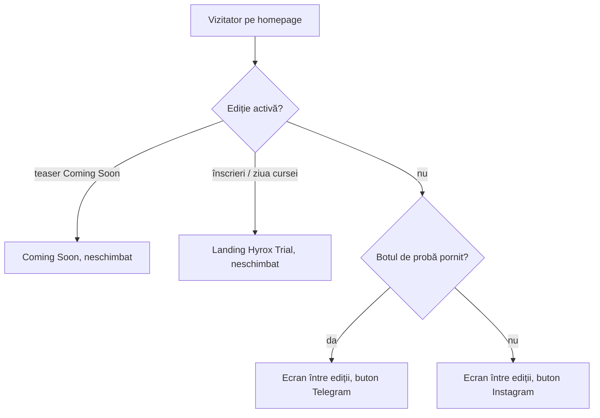
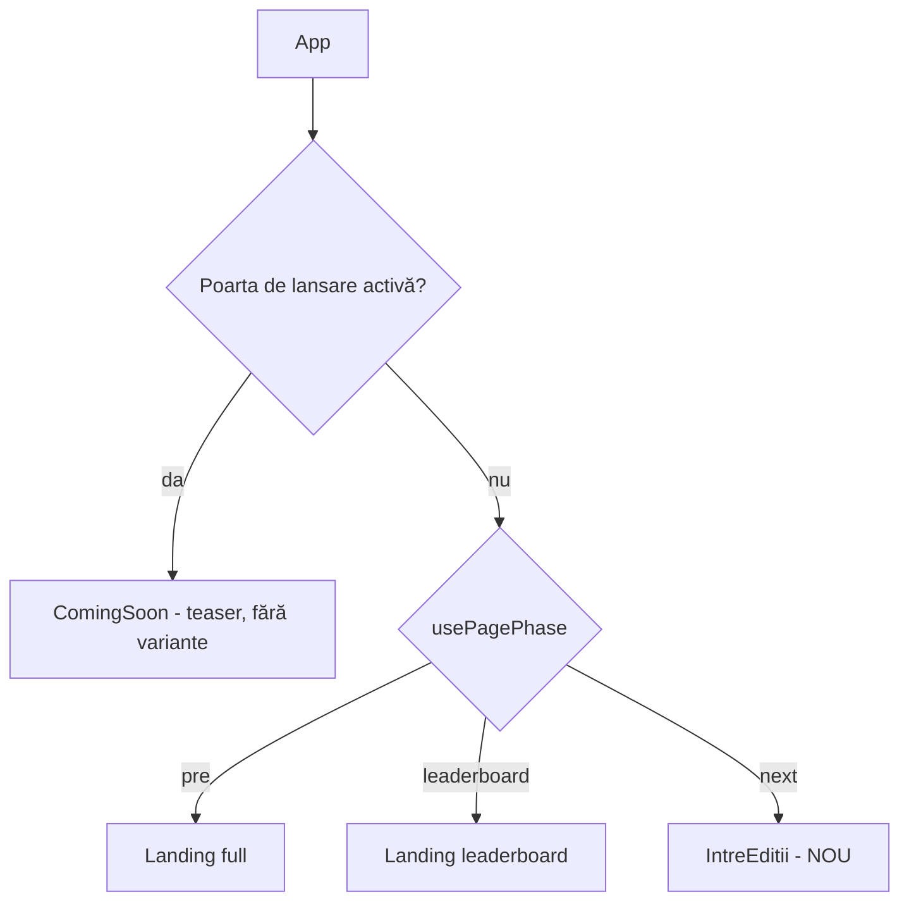
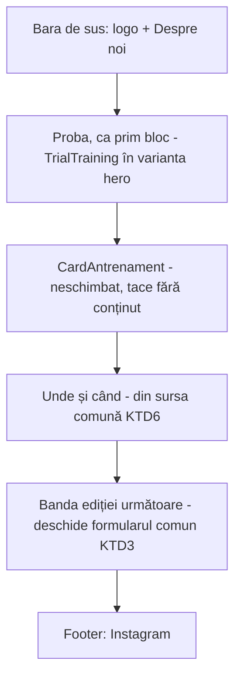

# Homepage între ediții, cu antrenamentul de probă în față - Plan

## Goal Capsule

- **Objective:** cât timp nu există o ediție activă, cine intră pe homepage înțelege din primul ecran că poate veni la un antrenament de probă și ajunge la el dintr-o apăsare; când o ediție devine activă, homepage-ul e cel de dinainte.
- **Means:** un ecran propriu „între ediții", randat în locul variantei `next-session` a Coming Soon, compus din piese existente (KTD1).
- **Authority:** planul ăsta, pe zona „homepage între ediții". Antrenamentul săptămânii din HYROX oficial și programul HYROX-only sunt zone separate, nu fac parte din scopul de aici (vezi How This Work Fits Together). Product Contract definește comportamentul, Planning Contract implementarea. Unde codul contrazice planul, codul câștigă și se notează.
- **Execution profile:** React + CSS, fără migrare SQL, fără funcție Edge, fără schimbare de build. Deploy prin merge în `main`.
- **Stop conditions:** oprește-te și întreabă dacă (a) R2 nu poate fi ținut fără să atingi `Landing.tsx` sau ramura de lansare din `App.tsx`; (b) extragerea formularului (U1) cere schimbarea `useLaunchForm` sau a contractului backend al listei; (c) separarea „se încarcă" de „oprit" (U2) cere schimbarea RPC-ului `public_trial_config`.
- **Tail ownership:** implementare + verificare locală (`npm run verify`). Merge-ul și verificarea pe producție rămân ale operatorului.
- **Open blockers:** niciunul.

---

## Product Contract

**Product Contract preservation:** Product Contract unchanged; două întrebări deferred rezolvate pe loc (previzualizarea `?preview=next` rămâne, vezi KTD5; forma ecranului, vezi KTD1).

### Summary

Între ediții, homepage-ul nu mai e o sală de așteptare pentru următoarea cursă, ci o invitație la primul antrenament. În ordine: „Primul tău antrenament cu noi", antrenamentul săptămânii, unde și când ne antrenăm, apoi o bandă mică pentru ediția următoare. Cât timp o ediție e activă, nimic nu se schimbă.

### Problem Frame

Următoarele două luni nu au nicio ediție. După ultima cursă, homepage-ul a trecut în faza `next`: titlul „Ne vedem curând", un countdown spre `nextEditionAt` și butonul „Anunță-mă la lansare". Countdown-ul numără spre o dată care nu mai are o ediție în spate, iar întreaga pagină promite un eveniment care nu există încă.

Singurul lucru pe care un om nou îl poate face acum cu Run + Lift este să vină la un antrenament de marți sau joi. Fluxul pentru asta există deja (botul de probă din Telegram, `docs/plans/2026-10-08-1339-feat-antrenament-proba-telegram-plan.md`), dar pe ecranul dintre ediții secțiunea „Primul tău antrenament cu noi" stă la final, sub countdown, sub formularul de notificare și sub cardul antrenamentului.

### Key Decisions

- **Comutarea e automată, legată de ediție, nu un comutator în admin.** Nimic de ținut minte de pornit sau de oprit; prețul e că modul de probă nu poate fi forțat peste o ediție activă. Governs R1, R2. (session-settled: user-approved — chosen over un comutator în /admin și peste un mod de probă permanent: un comutator uitat pornit ar putea ascunde o ediție nouă)
- **Ediția activă înseamnă comportamentul de dinainte, neschimbat.** Teaser-ul Coming Soon, landing-ul cu înscrieri și fereastra „cine vine" rămân exact cum sunt. Governs R2. (session-settled: user-directed — chosen over extinderea modului de probă peste ediție: „când avem o ediție activă, pagina se comportă cum era înainte")
- **Varianta B: proba, apoi antrenamentul săptămânii, apoi unde și când, apoi banda ediției.** Aleasă dintre trei schițe. Governs R4–R8. (session-settled: user-directed — chosen over A „doar proba", fără antrenament, și peste C „probă + clipuri + antrenament": B arată că se întâmplă ceva în fiecare săptămână fără să încarce pagina)
- **Fără countdown între ediții.** Ținta lui nu mai are o ediție în spate, deci pagina ar părea abandonată. Governs R9.
- **Bot oprit: același mesaj, alt canal.** Când botul de probă e oprit, pagina nu revine la „Ne vedem curând"; butonul duce la Instagram. Governs R10. (session-settled: user-approved — chosen over revenirea la ecranul de azi și peste mutarea antrenamentului în față: oprirea botului e o problemă de canal, nu „nu mai primim oameni noi")

### Requirements

**Când apare**

- R1. Între ediții, adică după finalul ultimei ediții și până când o ediție nouă devine activă, homepage-ul afișează ecranul descris de R4–R9 în locul ecranului „Ne vedem curând".
- R2. Cât timp o ediție e activă, homepage-ul se comportă exact ca înainte de schimbarea asta. Ediție activă înseamnă teaser-ul Coming Soon al ediției următoare, landing-ul cu înscrieri sau fereastra „cine vine" din ziua cursei.
- R3. Trecerea dintr-o stare în alta se face singură, după datele ediției publicate, fără redeploy și fără acțiune în `/admin`.

**Ce conține, în ordine**

- R4. Primul bloc, cel care ocupă primul ecran, este „Primul tău antrenament cu noi": eticheta, titlul, textul, cei trei pași și butonul „Vreau la un antrenament" spre Telegram, cu alternativa Instagram pentru cine n-are Telegram.
- R5. Al doilea bloc este antrenamentul săptămânii curente, cu trimitere spre `/antrenament`. Când nu are ce arăta, dispare fără să lase o gaură sau o eroare, ca azi.
- R6. Al treilea bloc arată unde și când ne antrenăm, din aceeași sursă ca `/despre-noi`, ca cele două pagini să nu poată spune lucruri diferite.
- R7. Ultimul bloc înainte de footer este o bandă mică: „Următoarea ediție Hyrox Trial: anunțăm curând", cu acțiunea „Anunță-mă" spre lista de notificare existentă.
- R8. Bara de sus păstrează logo-ul și linkul „Despre noi"; footer-ul păstrează Instagram.
- R9. Ecranul dintre ediții nu are countdown și nu afișează nicio dată a ediției următoare.

**Botul de probă oprit**

- R10. Când botul de probă e oprit în `/admin` sau are un username invalid, blocul R4 rămâne cu același titlu și text, iar butonul principal duce la Instagram în locul Telegram.

**Măsurare**

- R11. Butonul spre Telegram de pe homepage păstrează sursa `home`, ca pornirile de pe site să rămână distinse în bot de cele din share sau Instagram.

### Key Flows

- F1. Om nou între ediții
  - **Trigger:** cineva deschide homepage-ul dintr-un link din bio, story sau căutare, când nu e nicio ediție activă.
  - **Steps:** vede „Primul tău antrenament cu noi" pe primul ecran; apasă „Vreau la un antrenament"; Telegram se deschide pe botul de probă, cu sursa `home`; de acolo continuă fluxul de probă existent.
  - **Covered by:** R1, R4, R11

- F2. Ediția următoare devine activă
  - **Trigger:** organizatorul configurează ediția următoare și publică teaser-ul sau deschide înscrierile.
  - **Steps:** la momentul publicat, homepage-ul trece singur pe Coming Soon sau pe landing; ecranul dintre ediții nu mai apare până după finalul acelei ediții.
  - **Covered by:** R2, R3

### Acceptance Examples

- AE1. **Covers R1, R4–R9.** **Given** ultima ediție s-a încheiat și nu e configurată alta, **when** cineva deschide homepage-ul pe telefon, **then** primul ecran e „Primul tău antrenament cu noi", urmat de antrenamentul săptămânii, de unde și când, apoi de banda ediției, fără niciun countdown.
- AE2. **Covers R2, R3.** **Given** organizatorul a configurat ediția următoare cu teaser Coming Soon, **when** începe teaser-ul, **then** homepage-ul arată Coming Soon exact ca înainte, nu ecranul dintre ediții.
- AE3. **Covers R2.** **Given** o ediție are înscrierile deschise, **when** cineva deschide homepage-ul, **then** vede landing-ul Hyrox Trial ca înainte, cu „Primul tău antrenament cu noi" ca secțiune, în locul de azi.
- AE4. **Covers R10.** **Given** suntem între ediții și botul de probă e oprit în `/admin`, **when** cineva deschide homepage-ul, **then** vede același prim bloc, iar butonul principal deschide Instagram.
- AE5. **Covers R5.** **Given** suntem între ediții și programul săptămânal e gol sau cererea pică, **when** pagina se încarcă, **then** blocul antrenamentului lipsește, iar restul paginii arată normal.

### Success Criteria

- În cele două luni fără ediție, pornirile botului de probă cu sursa `home` cresc față de perioada în care proba stătea la finalul paginii. Pragul nu a fost fixat; e o presupunere, nu un angajament.

### Scope Boundaries

- Conținutul antrenamentului săptămânii nu se schimbă aici. Cardul arată programul vostru, cum îl arată azi.
- Landing-ul unei ediții active și Coming Soon-ul de dinainte de anunț nu se ating.
- Clipurile de antrenament (banda de reels) nu intră pe ecranul dintre ediții; au fost respinse odată cu varianta C.
- Nu se adaugă un comutator în `/admin` pentru acest mod.

### Dependencies / Assumptions

- Starea „ediție activă" se poate deriva din datele ediției deja publicate (finalul ediției, data lansării, teaser-ul). Planificarea confirmă că ajung pentru R1–R3 fără câmpuri noi.
- „Unde și când" pentru antrenamente are deja o singură sursă, folosită de `/despre-noi`.

### Outstanding Questions

**Deferred to Planning**

- Titlul și descrierea de share ale homepage-ului (meta, Open Graph) vin din ediție și numesc ultima cursă. Rămân neschimbate în lucrarea asta; vezi Deferred to Follow-Up Work.

### Sources / Research

- `src/App.tsx`, `src/hooks/usePagePhase.ts`: alegerea dintre Coming Soon, landing, „cine vine" și faza `next`.
- `src/components/ComingSoon.tsx`: ecranul de azi dintre ediții (varianta `next-session`), cu `CardAntrenament`; `TrialTraining` apare pe ambele variante ale ecranului.
- `src/components/TrialTraining.tsx`, `src/lib/trialPublic.ts`: secțiunea de probă, care azi dispare când botul e oprit, și linkul cu sursa `home`.
- `src/components/CardAntrenament.tsx`: cardul antrenamentului săptămânii, care tace când n-are ce arăta.
- `src/content/format.ts` (`TRAINING_WHERE`), `src/components/DespreNoi.tsx`: unde și când ne antrenăm.
- `bot/src/lib/trial.ts`: botul distinge sursele `trial_home`, `trial_share`, `trial_instagram`.

---

<!-- ce-section: work-relationships -->
## How This Work Fits Together

Planul ăsta acoperă doar homepage-ul dintre ediții. Restul e înțelegerea de acum, nu un roadmap asumat.

- Antrenamentul săptămânii din programul oficial HYROX („HYROX workout of the week") în locul sau alături de antrenamentele proprii.
  - Shares: cardul antrenamentului săptămânii din R5. Dacă sursa conținutului se schimbă, cardul de pe homepage o preia fără ca planul ăsta să se schimbe.
  - Still to decide: dacă și cum se poate folosi conținutul HYROX (preluare, rezumat sau doar link), ținând cont de drepturile asupra lui.
- Un ghid sau program opțional doar HYROX.
  - Depends on: decizia despre antrenamentul HYROX al săptămânii.
  - Can proceed independently of: planul ăsta.

---

## Planning Contract

### Key Technical Decisions

- KTD1. **Un ecran propriu „între ediții", nu a treia variantă a Coming Soon.** `ComingSoon` amestecă azi două ecrane prin `variant`; al treilea conținut ar transforma fiecare ramură într-un `urmatorul ? … : …`. Ecranul nou compune piese existente, iar `ComingSoon` rămâne doar teaser-ul de dinainte de anunț, fără prop-urile `variant` și `target`. Implements R1, R4–R9.
- KTD2. **Comutarea rămâne exact cea de azi; se schimbă doar ce se randează pe ea.** În `App.tsx`, ramura `phase === 'next'` (sub poarta de lansare) devine ecranul nou. `usePagePhase`, poarta de lansare și `Landing` nu se ating. Implements R1–R3. (session-settled: user-approved — chosen over un comutator în /admin: un comutator uitat pornit ar putea ascunde o ediție nouă)
- KTD3. **Formularul „Anunță-mă" se extrage din `ComingSoon` într-o componentă comună.** Modalul, Esc, overlay-ul, ecranul de succes și toast-urile trec într-o piesă folosită de ambele ecrane, pe același `useLaunchForm`. Banda din R7 deschide același formular, deci aceeași listă de notificare. Implements R7.
- KTD4. **Configul probei devine tristare: se încarcă, pornit, oprit.** Azi `usePublicTrial` dă `null` și la încărcare, și la oprire, iar fallback-ul spre Instagram (R10) ar clipi înaintea butonului Telegram. Pe durata încărcării, zona butonului rămâne goală; „oprit" include eroarea de rețea și username-ul invalid. Landing-ul păstrează comportamentul de azi: secțiunea lipsește dacă nu e „pornit". Implements R10, R2.
- KTD5. **`?preview=next` arată ecranul nou.** Valoarea există deja și e folosită de teste și de organizator; nu se adaugă una nouă.
- KTD6. **Programul antrenamentelor (zile, oră, loc) iese din `DespreNoi` într-o sursă comună de conținut.** Ambele pagini citesc aceleași rânduri, ca să nu poată spune lucruri diferite. Implements R6.

### High-Level Technical Design

Alegerea ecranului (neschimbată în afară de ultima ramură):

Compunerea ecranului nou, de sus în jos:

### Assumptions

- Componenta cardului antrenamentului se poate muta între ecrane fără schimbări; testele ei rulează deja pe `?preview=next`.
- `NEXT_EDITION_DATE` rămâne în config (o folosesc testele și adminul); dacă `knip` îl raportează ca nefolosit după U4, se scoate doar consumul, nu câmpul din config.

- Copy-ul probei în starea oprit și ordinea titlu–buton pe mobil (U2, pașii 4–5) sunt valorile implicite propuse de review, neconfirmate explicit de utilizator; se pot ajusta la review-ul PR-ului.
- Blocul „unde și când" arată rândurile Când, Unde și Ora, compact, cu link spre `/despre-noi`.
- Cererea de config nu primește un timeout propriu în lucrarea asta; o cerere blocată lasă zona butonului goală până răspunde browserul.

### Deferred to Follow-Up Work

- Meta / Open Graph ale homepage-ului între ediții.
- Curățarea stilurilor `cs-*` rămase nefolosite după U4, dacă nu cade natural în U4.

---

## Implementation Units

### U1. Formularul „Anunță-mă" ca piesă comună

- **Goal:** modalul listei de notificare devine o componentă reutilizabilă, iar Coming Soon îl folosește fără nicio schimbare vizibilă.
- **Requirements:** R7 (pregătire), R2. KTD3.
- **Dependencies:** niciuna.
- **Files:** `src/components/ComingSoon.tsx`, `src/components/AnuntaMa.tsx` (nou; numele final la implementare), `tests/coming-soon.spec.ts`.
- **Approach:**
  1. Mută în componenta nouă: starea `open`/`duplicate`, `useLaunchForm`, Esc, clic pe overlay, ecranul de succes, toast-urile prin `showToast` primit ca prop.
  2. Componenta primește eticheta butonului care o deschide sau expune o funcție de deschidere; alege forma cea mai simplă pentru doi consumatori.
  3. `ComingSoon` o folosește cu textele de azi.
- **Execution note:** testele existente din `tests/coming-soon.spec.ts` („Coming Soon — formular") sunt caracterizarea; rulează-le înainte și după, nu le modifica.
- **Patterns to follow:** formularul actual din `src/components/ComingSoon.tsx`; `src/hooks/useLaunchForm.ts`.
- **Test scenarios:**
  - Toate testele „Coming Soon — formular" trec neschimbate (4 câmpuri, validare goală, email invalid, 201, 409, 500, Esc/overlay, după expirarea countdown-ului).
- **Verification:** Coming Soon arată și se comportă identic; diff-ul `ComingSoon.tsx` e doar extragere.

### U2. Proba: tristare și varianta de prim bloc cu fallback Instagram

- **Goal:** secțiunea de probă poate fi primul bloc al ecranului dintre ediții și știe să ducă la Instagram când botul e oprit, fără să clipească.
- **Requirements:** R4, R10, R11, R2. KTD4. AE4.
- **Dependencies:** niciuna.
- **Files:** `src/hooks/usePublicTrial.ts`, `src/components/TrialTraining.tsx`, `src/components/trial-training.css`, `src/components/Landing.tsx` (doar dacă semnătura hookului o cere), `tests/unit/trialUi.test.tsx`.
- **Approach:**
  1. Hookul raportează trei stări: se încarcă, pornit (cu config), oprit. Eroarea de rețea și configul invalid înseamnă oprit.
  2. `TrialTraining` primește o variantă de prim bloc. În ea: la încărcare, zona butonului e goală; pornit, butonul Telegram cu sursa `home`; oprit, butonul principal „Scrie-ne pe Instagram".
  3. Varianta de azi (în landing) rămâne: randează doar când e pornit (R2).
  4. Titlul, eticheta și pașii sunt aceiași în toate stările. În starea oprit, paragraful nu mai pomenește Telegram (de ex. „Vino să ne cunoști la un antrenament de probă. Scrie-ne pe Instagram și alegem împreună ziua potrivită."), textul de sub buton vorbește despre Instagram, iar rândul „Nu ai Telegram?" dispare.
  5. Pe mobil, varianta de prim bloc pune butonul imediat sub titlu, apoi paragraful și pașii, ca titlul și butonul să încapă în primul ecran la 375×667.
  6. O cerere anulată (AbortError, StrictMode în dev) nu schimbă starea; doar o eroare reală sau un config invalid duc în oprit. Zona butonului își rezervă înălțimea la încărcare, ca să nu sară conținutul de dedesubt.
- **Patterns to follow:** `trialLink` din `src/lib/trialPublic.ts`; testele „intrarea la proba" din `tests/unit/trialUi.test.tsx`.
- **Test scenarios:**
  - Varianta de prim bloc, pornit: linkul „Vreau la un antrenament" are `https://t.me/<bot>?start=trial_home`.
  - Covers AE4. Varianta de prim bloc, oprit: titlul „Primul tău antrenament cu noi." e vizibil, linkul principal duce la `INSTAGRAM_URL`, niciun link `t.me`.
  - Varianta de prim bloc, username invalid: același rezultat ca la oprit.
  - Varianta de prim bloc, se încarcă: titlul e vizibil, niciun link de acțiune.
  - Varianta de landing, oprit: nu randează nimic (testul existent rămâne verde).
  - Hookul: cererea care pică ajunge în starea oprit, nu rămâne în încărcare.
  - Hookul: o cerere anulată la demontare nu trece starea în oprit.
  - Varianta de prim bloc, oprit: paragraful nu conține „Telegram" și nu există rândul „Nu ai Telegram?".
- **Verification:** testele unitare noi și cele existente trec; landing-ul arată secțiunea exact ca înainte.

### U3. Programul antrenamentelor ca sursă comună

- **Goal:** zilele, ora și locul antrenamentelor se citesc dintr-un singur loc de `/despre-noi` și de ecranul nou.
- **Requirements:** R6. KTD6.
- **Dependencies:** niciuna.
- **Files:** `src/content/format.ts` (sau un modul alăturat), `src/components/DespreNoi.tsx`, `tests/despre-noi.spec.ts`.
- **Approach:** mută rândurile `ORAR` (Când, Unde, Ora, Unde ne găsești) lângă `TRAINING_WHERE`, construite din `EDITION.training`; `DespreNoi` le importă. Fără schimbare vizibilă pe `/despre-noi`.
- **Test scenarios:**
  - `tests/despre-noi.spec.ts` trece neschimbat (inclusiv paza „un singur request").
  - Test expectation pentru modulul de conținut: none — date constante, acoperite prin cele două pagini.
- **Verification:** `/despre-noi` identic; constanta e exportată o singură dată.

### U4. Ecranul „între ediții" și comutarea în App

- **Goal:** în faza `next`, homepage-ul arată ecranul nou; Coming Soon rămâne doar teaser.
- **Requirements:** R1–R9, R11. KTD1, KTD2, KTD5. F1, F2. AE1, AE2, AE3, AE5.
- **Dependencies:** U1, U2, U3.
- **Files:** `src/components/IntreEditii.tsx` (nou), stiluri (fișier propriu după modelul `trial-training.css` sau `src/public.css`), `src/App.tsx`, `src/components/ComingSoon.tsx`, `tests/intre-editii.spec.ts` (nou), `tests/faze.spec.ts`, `tests/card-antrenament.spec.ts`, `tests/navigare.spec.ts`, `tests/trial.spec.ts`, `tests/unit/claseCss.test.ts` (dacă apare o foaie de stil nouă).
- **Approach:**
  1. Compune ecranul în ordinea din R4–R8: bara de sus, proba în varianta de prim bloc (U2), `CardAntrenament`, unde și când (U3), banda ediției cu formularul comun (U1), footer.
  2. Fără countdown și fără dată a ediției următoare (R9). Textul benzii: „Următoarea ediție Hyrox Trial: anunțăm curând".
  3. În `App.tsx`, ramura `phase === 'next'` randează ecranul nou; restul ramurilor nu se ating (KTD2).
  4. Scoate din `ComingSoon` prop-urile `variant`/`target`, ramurile `urmatorul` și `CardAntrenament`. `TrialTraining` rămâne în teaser, în varianta de landing (apare doar când botul e pornit), ca azi (R2); teaser-ul rămâne neschimbat vizual.
  5. Pe mobil, primul ecran trebuie să conțină titlul probei și butonul (R4).
- **Patterns to follow:** compunerea din `src/components/Landing.tsx`; tăcerea cardului din `src/components/CardAntrenament.tsx`; `fixClock` și `DUPA_CURSA` din `tests/faze.spec.ts`.
- **Test scenarios:**
  - Covers AE1. După finalul cursei (`DUPA_CURSA`), `/` arată în ordine: titlul probei, cardul antrenamentului, blocul „unde și când", banda ediției; `role=timer` are 0 elemente.
  - Covers AE1. Pe 375×667, titlul probei și butonul sunt în primul viewport; fără scroll orizontal (înlocuiește cazul „countdown-ul spre următorul antrenament" din testul de mobil).
  - Covers AE2. Cu poarta de lansare activă (`?preview=soon` sau config cu `showComingSoon` și `launchAt` în viitor), `/` arată Coming Soon cu countdown-ul lui, nu ecranul nou.
  - Covers AE3. Cu înscrierile deschise, `/` arată landing-ul complet, cu secțiunea de probă la locul de azi.
  - Covers AE5. Între ediții, cu programul gol sau cu cererea picată, cardul lipsește, iar proba, „unde și când" și banda sunt vizibile.
  - Banda: clic pe „Anunță-mă" deschide formularul comun; submit valid (mock 201) arată ecranul de succes.
  - `?preview=next` înainte de ora finalului arată ecranul nou (rescrie testul existent care caută `.cs-root`).
  - Rescrie cele două teste din „Faza next" care verifică countdown-ul: acum ecranul nou e prezent și nu există countdown.
  - Testul din `card-antrenament.spec.ts` care verifică absența cardului pe Coming Soon rămâne valid; cele pe `?preview=next` trec cu cardul mutat în ecranul nou.
  - Aserțiunile care caută `.cs-root` în faza `next` se mută pe rădăcina ecranului nou: `faze.spec.ts` („/inscriere după cursă duce la homepage"), `card-antrenament.spec.ts` (program gol pe `?preview=next`), `navigare.spec.ts` („Despre noi → înapoi la /", lista de rădăcini acceptate).
  - `trial.spec.ts` rămâne verde pe toate fazele, inclusiv `soon` (proba încă apare în teaser când botul e pornit).
- **Verification:** toate scenariile de mai sus trec; teaser-ul Coming Soon și landing-ul sunt identice vizual cu `main`.

---

## Verification Contract

| Verificare | Comandă | Ce dovedește |
|---|---|---|
| Lint, cod mort, tipuri | `npm run lint`, `npm run deadcode`, `npm run typecheck`, `npm run typecheck:tests` | fără importuri sau exporturi rămase după extragere (U1, U4) |
| Unit | `npm run test:coverage` | U2: tristarea și cele trei stări ale butonului |
| Build | `npm run build` | aplicația se construiește |
| E2E | `npm run test:e2e:preview` | U1, U3, U4: Coming Soon, `/despre-noi`, fazele, ecranul nou, mobil |
| Tot | `npm run verify` | poarta folosită de CI |

Verificare manuală: `/?preview=next` pe telefon, cu botul pornit și apoi oprit din `/admin`.

## Definition of Done

- Toate unitățile U1–U4 sunt implementate, iar fiecare scenariu de test listat există și trece.
- `npm run verify` trece local.
- Teaser-ul Coming Soon, landing-ul și `/despre-noi` arată identic cu `main` (R2).
- Nu rămâne cod din încercări abandonate, nici stiluri sau prop-uri moarte introduse de această lucrare.
- Per unitate: U1 — testele formularului neschimbate și verzi; U2 — fără clipire la încărcare; U3 — o singură definiție a programului; U4 — ecranul nou în faza `next`, fără countdown.
