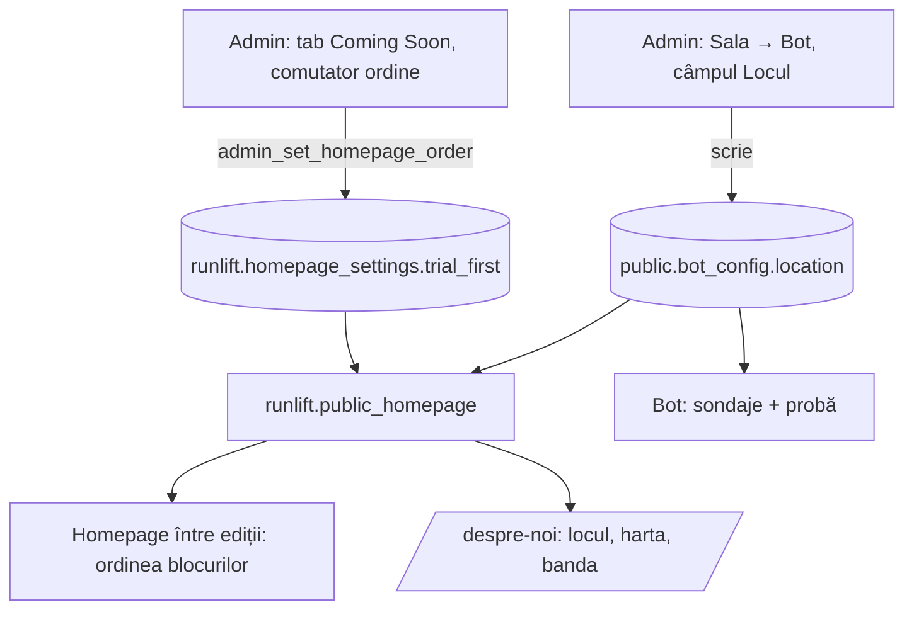

# Homepage între ediții cu ordine configurabilă și locația antrenamentelor din setări - Plan

## Goal Capsule

- **Objective:** între ediții, homepage-ul arată ca înainte de redesignul „proba e primul bloc” („Ne vedem curând”), iar organizatorul decide din /admin ce vine primul sub butoane: antrenamentul săptămânii sau „Primul tău antrenament cu noi”. Locul antrenamentelor afișat pe site e mereu același cu cel din sondajele și botul de probă din Telegram.
- **Means:** revertul PR #68, un comutator de ordine cu efect imediat în tabul Coming Soon din /admin și o funcție publică care dă site-ului ordinea și locația botului (KTD1–KTD4).
- **Authority:** planul ăsta. Înlocuiește direcția din PR #68 (`docs/plans/2026-10-11-1104-feat-homepage-proba-intre-editii-plan.md`, șters odată cu revertul). Product Contract definește comportamentul, Planning Contract implementarea. Unde codul contrazice planul, codul câștigă și se notează.
- **Execution profile:** React + CSS, o migrare SQL în schema `runlift` aplicată manual (vezi `MIGRATIONS.md`), fără funcție Edge, fără schimbare de build. Deploy prin merge în `main`.
- **Stop conditions:** oprește-te și întreabă dacă (a) revertul PR #68 are conflicte cu ce a intrat în `main` după el; (b) `public.bot_config` nu poate fi citit dintr-o funcție `security definer` din `runlift`; (c) R1 nu poate fi ținut fără să atingi landing-ul unei ediții active.
- **Tail ownership:** implementare + verificare locală (`npm run verify`). Aplicarea migrării pe producție, merge-ul și verificarea live rămân ale operatorului.
- **Open blockers:** niciunul.

---

## Product Contract

**Product Contract preservation:** changed: R1 și prima Key Decision. PR #68 a fost merge-uit în `main` (11 octombrie, 11:39) înainte de planificare, deci „ca în producție” nu mai descrie ecranul dorit; reperul devine ecranul de dinainte de PR #68 (commit `3d51379`), cel din screenshot-ul organizatorului. Intenția e neschimbată. R7 e acoperit de câmpul existent „Locul” din Sala → Bot, fără UI nou. Cele două întrebări amânate sunt rezolvate în KTD2 și KTD4.

### Summary

Ecranul dintre ediții revine la cel de dinainte de redesign, cu o singură schimbare vizibilă: ordinea dintre cardul „Până atunci” și secțiunea „Primul tău antrenament cu noi” se alege din /admin. Locația antrenamentelor nu mai e scrisă în codul site-ului. Vine din setarea comună cu botul, editabilă din /admin.

### Problem Frame

Redesignul de azi („proba e primul bloc”, PR #68) a înlocuit ecranul „Ne vedem curând” cu unul nou. Organizatorului îi place ecranul vechi și vrea doar să poată pune proba deasupra antrenamentului, sau invers, după perioadă.

Separat, antrenamentele nu mai au loc în parc. Botul ia deja locul dintr-o setare editabilă, dar site-ul îl are scris în cod („Teren Sportiv, Parcul Râșcani”), plus rândul fix „În aer liber, în parc” pe `/despre-noi`. Azi, o mutare cere un deploy și lasă site-ul să contrazică botul.

### Key Decisions

- **Pornim din ecranul de dinainte de PR #68, nu din redesign.** PR #68 se revertează. Governs R1. (session-settled: user-directed — chosen over ecranul nou „proba e primul bloc”: „îmi place mult cum era înainte”)
- **Ordinea se alege dintr-un comutator în /admin, nu se inversează fix în cod.** Organizatorul o schimbă oricând, fără deploy. Governs R2–R5. (session-settled: user-approved — chosen over o inversare fixă în cod: revenirea ar cere o modificare de cod)
- **O singură locație, comună cu botul.** Site-ul citește aceeași setare pe care o folosesc sondajele și botul de probă. Governs R6–R9. (session-settled: user-approved — chosen over un câmp separat doar pentru site: două surse pot spune locuri diferite)
- **Comutatorul atinge doar ecranul dintre ediții.** Landing-ul unei ediții active își păstrează ordinea de azi. Governs R4.

### Requirements

**Ecranul dintre ediții**

- R1. Între ediții, homepage-ul arată și se comportă ca înainte de PR #68 (commit `3d51379`): badge, titlul „Ne vedem curând”, textul, butoanele „Anunță-mă la lansare” și „Află mai multe”, apoi cele două blocuri de sub butoane.
- R2. /admin are o setare de ordine cu două valori: „Antrenamentul săptămânii primul” (implicit, ordinea de dinainte) și „Proba primul”.
- R3. Cu „Proba primul”, „Primul tău antrenament cu noi” apare imediat sub butoane, iar cardul „Până atunci” sub el; conținutul și comportamentul fiecărui bloc rămân neschimbate.
- R4. Setarea se aplică doar ecranului dintre ediții; Coming Soon-ul de dinainte de anunț și landing-ul unei ediții active nu se schimbă.
- R5. O schimbare a ordinii apare pe site fără deploy. Dacă setarea nu se poate citi, pagina folosește ordinea implicită.

**Locația antrenamentelor**

- R6. Site-ul afișează locația antrenamentelor din aceeași setare pe care o folosesc botul de sondaje și botul de probă.
- R7. /admin permite editarea locației; valoarea salvată apare pe site, în sondajele următoare și în botul de probă, fără deploy.
- R8. Pe `/despre-noi`, harta arată locația curentă din setare, iar rândul fix „În aer liber, în parc” dispare.
- R9. Dacă setarea nu se poate citi, site-ul afișează în continuare o locație, fără gol sau eroare.

### Acceptance Examples

- AE1. **Covers R1, R2.** **Given** nu e nicio ediție activă și setarea e la valoarea implicită, **when** cineva deschide homepage-ul, **then** vede ecranul de dinainte de PR #68, cu „Până atunci” deasupra „Primul tău antrenament cu noi”.
- AE2. **Covers R3, R5.** **Given** organizatorul alege „Proba primul” în /admin, **when** cineva reîncarcă homepage-ul, **then** „Primul tău antrenament cu noi” e imediat sub butoane și „Până atunci” sub el, fără niciun deploy.
- AE3. **Covers R4.** **Given** setarea e „Proba primul” și o ediție are înscrierile deschise, **when** cineva deschide homepage-ul, **then** landing-ul arată exact ca înainte.
- AE4. **Covers R6, R7, R8.** **Given** organizatorul schimbă locația în /admin într-o sală, **when** cineva deschide `/despre-noi`, **then** vede sala ca loc și pe hartă, fără „În aer liber, în parc”, iar următorul sondaj din grup numește aceeași sală.
- AE5. **Covers R5, R9.** **Given** funcția publică nu răspunde, **when** cineva deschide homepage-ul și `/despre-noi`, **then** homepage-ul are ordinea implicită, iar `/despre-noi` arată locația din cod, fără eroare.

### Scope Boundaries

- Zilele și ora antrenamentelor de pe site rămân scrise în cod, deși botul are și el aceste setări.
- Conținutul cardului „Până atunci” și al secțiunii de probă nu se schimbă.
- Fără alte opțiuni de configurare a homepage-ului (ascunderea blocurilor, texte editabile).
- Locații diferite pe zile sau pe sesiune nu intră aici; botul le poate muta deja pe sesiune prin `/muta`.
- Piesele din PR #68 care nu țin de ecran (butonul Instagram când botul de probă e oprit, extragerea formularului „Anunță-mă”, sursa unică a programului) pleacă odată cu revertul și nu se refac aici.

### Deferred to Follow-Up Work

- Legarea zilelor și a orei de pe site la setările botului, pe același drum ca locația.
- Actualizarea locației de rezervă din cod la noul loc, când organizatorul îl comunică.

### Sources / Research

- `src/components/ComingSoon.tsx` la `3d51379`: ecranul din screenshot (varianta `next-session`), cu `CardAntrenament` în `<main>` și `TrialTraining` după el.
- `src/components/Landing.tsx`: landing-ul cu ediție activă, care își poziționează singur `TrialTraining`.
- `src/content/format.ts` (`TRAINING_PLACE`, `TRAINING_WHERE`), `src/content/edition.ts` (`training.place`), `src/components/DespreNoi.tsx` (harta, `ORAR`, `MARQUEE`).
- `src/admin/sala/EcranBot.tsx`, `src/admin/sala/configBot.ts`: câmpul „Locul”, care scrie deja `public.bot_config.location`.
- `bot/src/lib/trial.ts`, `bot/src/lib/poll-text.ts`: botul citește `bot_config.location`.
- `supabase/sql/supabase-migration-reels-si-coming-soon.sql` (`admin_set_coming_soon`), `src/admin/AdminComingSoonTab.tsx`: modelul de comutator cu efect imediat.
- `src/lib/trialPublic.ts`, `src/hooks/usePublicTrial.ts`: modelul de citire publică, care tace la eroare.

---

## Planning Contract

### Key Technical Decisions

- KTD1. **Revert întreg al PR #68, cu `git revert -m 1 981b48f`.** Un singur commit, reversibil, care readuce exact ecranul de la `3d51379` și testele lui. Cherry-pick-ul pieselor utile ar fi lăsat la latitudinea implementatorului ce înseamnă „ca înainte”. Instantiates R1.
- KTD2. **Ordinea stă într-un tabel nou cu un singur rând, `runlift.homepage_settings`, nu în documentul ediției și nici în `trial_config`.** Documentul ediției se înlocuiește la fiecare publicare și ar putea pierde cheia; `trial_config` se salvează doar cu toate câmpurile probei complete. Un tabel propriu nu se ciocnește cu nimic. Valoarea e un boolean `trial_first`, implicit `false`.
- KTD3. **O singură funcție publică, `runlift.public_homepage()`, întoarce `{ trial_first, training_location }`.** Răspunde indiferent dacă botul de probă e pornit; `public_trial_config` tace când botul e oprit, deci nu poate purta ordinea. Locația vine din `public.bot_config.location`, citită `security definer`, exact cum `public_trial_config` citește `public.trial_config`. Instantiates R5, R6.
- KTD4. **Comutatorul e un RPC de un gest, `runlift.admin_set_homepage_order(p_token, p_trial_first)`, afișat în tabul Coming Soon.** Același model ca `admin_set_coming_soon`: token verificat în funcție, rând în `admin_events`, efect imediat fără ciornă. Tabul Coming Soon e locul unde organizatorul controlează deja ce arată homepage-ul. Instantiates R2.
- KTD5. **Editarea locației rămâne câmpul existent „Locul” din Sala → Bot.** Scrie deja în `bot_config.location`, deci R7 nu cere UI nou; site-ul doar citește. Instantiates R7.
- KTD6. **Harta din `/despre-noi` caută textul locației.** `bot_config` are doar un text, fără coordonate; embed-ul și linkul de direcții folosesc textul codat URL. Pinul e mai puțin precis decât coordonatele de azi. La eroare sau înainte de răspuns, pagina folosește locul și harta din `EDITION.training.place`. Instantiates R8, R9.

### High-Level Technical Design

Sursele și cititorii, după schimbare. Diagramă direcțională, nu specificație.

Ordinea pe homepage, între ediții:

| `trial_first` | Sub butoane | Apoi |
|---|---|---|
| `false` (implicit, sau funcția nu răspunde) | `CardAntrenament` („Până atunci”) | `TrialTraining` |
| `true` | `TrialTraining` | `CardAntrenament` |

Fiecare bloc își păstrează regula de a dispărea când n-are ce arăta: cardul fără program, proba când botul e oprit.

### Assumptions

- Revertul PR #68 se aplică fără conflicte; după el, în `main` n-au intrat alte schimbări pe aceleași fișiere (verificat: `main` e la merge-ul PR #68).
- Proprietarul funcțiilor `runlift` poate citi `public.bot_config`; funcțiile `runlift.admin_sala_*` o fac deja.

### Sequencing

U1 → U2 → U3 → U4 → U5. U2 poate merge în paralel cu U1, dar U3–U5 pornesc din codul revertat.

---

## Implementation Units

### U1. Revertul PR #68

- **Goal:** homepage-ul revine la ecranul de la `3d51379`.
- **Requirements:** R1, R4 (Key Decision 1).
- **Dependencies:** niciuna.
- **Files:** toate fișierele din PR #68, inclusiv `src/components/IntreEditii.tsx`, `src/components/AnuntaMa.tsx`, `src/components/ComingSoon.tsx`, `src/App.tsx`, `src/hooks/usePublicTrial.ts`, `src/components/TrialTraining.tsx`, `tests/intre-editii.spec.ts`, `tests/unit/stareProba.test.tsx`.
- **Approach:** branch nou din `origin/main`, apoi `git revert -m 1 981b48f`. Fără editări manuale în același commit, ca revertul să rămână curat.
- **Patterns to follow:** —
- **Test scenarios:** testele readuse de revert (`tests/card-antrenament.spec.ts`, `tests/faze.spec.ts`, `tests/coming-soon.spec.ts`) trec neschimbate; ecranul dintre ediții are badge „Următorul antrenament”, titlul „Ne vedem curând”, cardul „Până atunci”, apoi secțiunea de probă.
- **Verification:** `git diff 3d51379 HEAD -- src tests` e gol; `npm run verify` trece.

### U2. Migrarea: setarea de ordine și funcția publică

- **Goal:** baza de date păstrează ordinea și o expune, împreună cu locația botului, fără autentificare.
- **Requirements:** R2, R5, R6, R9 (KTD2, KTD3, KTD4).
- **Dependencies:** niciuna.
- **Files:** `supabase/sql/supabase-migration-homepage-ordine-locatie.sql` (nou), `tests/unit/sql/db.ts` (adaugă migrarea în `MIGRARI_NEAPLICATE`), `tests/unit/sql/homepage.test.ts` (nou), `MIGRATIONS.md`.
- **Approach:** `create table if not exists runlift.homepage_settings` cu un singur rând (`id = 1`, `trial_first boolean not null default false`, `updated_at`), RLS pornit și fără politici, rândul inserat `on conflict do nothing`. `runlift.public_homepage()` e `stable security definer`, `search_path=''`, întoarce `jsonb` cu `trial_first` (implicit `false` fără rând) și `training_location` din `public.bot_config` (`null` fără rând). `runlift.admin_set_homepage_order(p_token uuid, p_trial_first boolean)` verifică tokenul, face upsert pe rândul unic, scrie în `admin_events` cu tipul `homepage_order_set`. Granturi ca la `public_trial_config` și `admin_set_coming_soon`. Migrarea se poate rula de mai multe ori.
- **Patterns to follow:** `admin_set_coming_soon` și granturile lui în `supabase/sql/supabase-migration-reels-si-coming-soon.sql`; `public_trial_config` în `supabase/sql/supabase-migration-trial-review-fixes.sql`; `tests/unit/sql/antrenament.test.ts`.
- **Test scenarios:**
  - `public_homepage()` ca `anon`, pe o bază nouă: `trial_first = false` și locația implicită a botului.
  - După `admin_set_homepage_order(token valid, true)`: `public_homepage()` întoarce `trial_first = true`, iar `admin_events` are un rând `homepage_order_set`.
  - Token invalid: excepție `invalid_token`, setarea rămâne neschimbată.
  - Locația schimbată în `bot_config`: `public_homepage()` o întoarce imediat.
  - `anon` nu poate citi sau scrie direct `runlift.homepage_settings`.
  - Migrarea rulată de două ori nu dă eroare și nu resetează `trial_first`.
- **Verification:** testele SQL trec; `MIGRATIONS.md` listează migrarea ca neaplicată, cu pașii pentru operator.

### U3. Homepage-ul citește ordinea

- **Goal:** ecranul dintre ediții așază cele două blocuri după setare.
- **Requirements:** R2, R3, R4, R5 (Key Decision 2, KTD3).
- **Dependencies:** U1, U2.
- **Files:** `src/lib/homepagePublic.ts` (nou), `src/hooks/usePublicHomepage.ts` (nou), `src/components/ComingSoon.tsx`, `tests/unit/homepagePublic.test.ts` (nou), `tests/coming-soon.spec.ts` sau `tests/card-antrenament.spec.ts`.
- **Approach:** un loader care cheamă `public_homepage` prin `rpc` și validează forma, plus un hook care tace la eroare și întoarce ordinea implicită până răspunde. În `ComingSoon`, doar pe varianta `next-session`, cele două blocuri se randează în ordinea dată de `trial_first`. Pe varianta `launch` nimic nu se schimbă. Primul bloc rămâne în `<main>`, ca înainte.
- **Patterns to follow:** `src/lib/trialPublic.ts`, `src/hooks/usePublicTrial.ts`; mock-urile de RPC din `tests/card-antrenament.spec.ts`.
- **Test scenarios:**
  - Covers AE1. RPC-ul răspunde `trial_first: false`: cardul „Până atunci” apare înaintea secțiunii „Primul tău antrenament cu noi” în DOM.
  - Covers AE2. `trial_first: true`: secțiunea de probă apare înaintea cardului.
  - Covers AE5. RPC-ul pică sau întoarce o formă greșită: ordinea implicită, fără mesaj de eroare.
  - Covers AE3. `trial_first: true` cu o ediție cu înscrieri deschise: landing-ul arată ca înainte.
  - `trial_first: true` și botul de probă oprit: doar cardul apare, fără gol.
  - Varianta `launch` (Coming Soon de dinainte de anunț) nu cheamă `public_homepage` și nu se schimbă.
- **Verification:** testele unitare și e2e trec; pe `npm run dev` cu `?preview=next`, ambele ordini se văd la comutare.

### U4. Comutatorul în /admin

- **Goal:** organizatorul schimbă ordinea dintr-un gest, cu efect imediat.
- **Requirements:** R2, R5 (Key Decision 2, KTD4).
- **Dependencies:** U2.
- **Files:** `src/lib/adminApi.ts`, `src/admin/AdminComingSoonTab.tsx`, `tests/unit/adminComingSoonTab.test.tsx`.
- **Approach:** în tabul Coming Soon, un grup „Ordinea pe ecranul dintre ediții” cu două opțiuni, „Antrenamentul săptămânii primul” și „Proba primul”. Valoarea curentă se citește din `public_homepage`; alegerea cheamă `admin_set_homepage_order` și confirmă cu toast. La eroare, selecția revine la valoarea salvată și apare un mesaj.
- **Patterns to follow:** `setComingSoon` în `src/lib/adminApi.ts`; `src/admin/controale/GrupRadio.tsx`; testele existente din `tests/unit/adminComingSoonTab.test.tsx`.
- **Test scenarios:**
  - La încărcare, opțiunea selectată corespunde valorii din `public_homepage`.
  - Alegerea „Proba primul” cheamă `admin_set_homepage_order` cu `p_trial_first: true` și tokenul sesiunii.
  - RPC-ul refuză: selecția revine la valoarea veche și apare mesajul de eroare.
  - Cât timp cererea e în zbor, controlul e dezactivat.
- **Verification:** testele unitare trec; în `/admin` local, comutarea se reflectă pe homepage la reîncărcare.

### U5. `/despre-noi` citește locația

- **Goal:** pagina arată locul din setarea botului, pe text și pe hartă.
- **Requirements:** R6, R8, R9 (Key Decision 3, KTD3, KTD6).
- **Dependencies:** U1, U3 (folosește același hook).
- **Files:** `src/components/DespreNoi.tsx`, `src/content/format.ts`, `tests/despre-noi.spec.ts`, `tests/unit/homepagePublic.test.ts`.
- **Approach:** o funcție pură care transformă textul locației în `where`, `embedSrc` și `directionsUrl` (căutare codată URL), cu rezervă pe `TRAINING_PLACE` când textul lipsește. `DespreNoi` folosește hook-ul din U3 pentru rândul „Unde”, titlul hărții, iframe, linkul de direcții și banda. Rândul „Unde ne găsești: În aer liber, în parc” se scoate; „În aer liber” din bandă rămâne, fiindcă descrie formatul, nu locul. Garda din `tests/despre-noi.spec.ts` („un singur request”) se actualizează la cele două funcții publice permise.
- **Patterns to follow:** `placeStrings` în `src/content/format.ts`.
- **Test scenarios:**
  - Covers AE4. RPC-ul întoarce `training_location: "Sala X"`: rândul „Unde”, titlul hărții și banda arată „Sala X”; `src` și linkul de direcții conțin textul codat.
  - Covers AE5. RPC-ul pică: pagina arată „Teren Sportiv, Parcul Râșcani” și harta cu coordonatele de azi, fără eroare.
  - Textul „În aer liber, în parc” nu mai apare pe pagină.
  - Text cu diacritice și virgule („Sala Ironworks, str. Ion Creangă”): codarea URL nu strică `src`.
  - Pagina face exact cererile permise de gardă, nu mai multe.
- **Verification:** testele unitare și e2e trec; `npm run verify` trece.

---

## Verification Contract

| Ce | Comandă | Când |
|---|---|---|
| Lint, cod mort, tipuri | `npm run lint`, `npm run deadcode`, `npm run typecheck`, `npm run typecheck:tests` | după fiecare unitate |
| Unitare + SQL (PGlite) | `npm run test:coverage` | U2–U5 |
| E2E pe build | `npm run test:e2e:preview` | U1, U3, U5 |
| Totul | `npm run verify` | înainte de PR |

Migrarea nu se aplică pe producție din plan. După aplicarea manuală de către operator, instantaneele `supabase/schema/*.sql` se regenerează, iar migrarea iese din `MIGRARI_NEAPLICATE`, într-un commit separat.

## Definition of Done

- U1–U5 sunt implementate, iar fiecare are verificarea ei trecută.
- `npm run verify` trece pe branch.
- Fără `public_homepage` live, site-ul se comportă ca înainte de PR #68 (ordinea implicită, locația din cod), deci merge-ul e sigur înaintea migrării. Până la migrare, comutatorul din /admin afișează eroarea lui obișnuită, fără să strice restul tabului.
- `MIGRATIONS.md` descrie migrarea nouă, ordinea de aplicare și verificarea după aplicare.
- Codul din încercări abandonate e scos din diff; nu rămân importuri, CSS sau teste fără folos (`npm run deadcode` curat).
