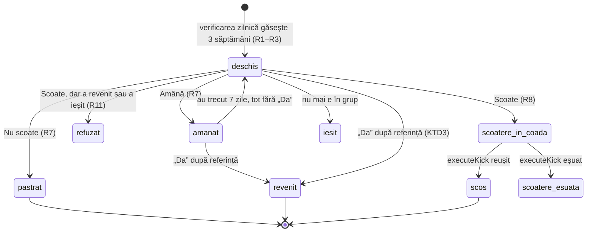
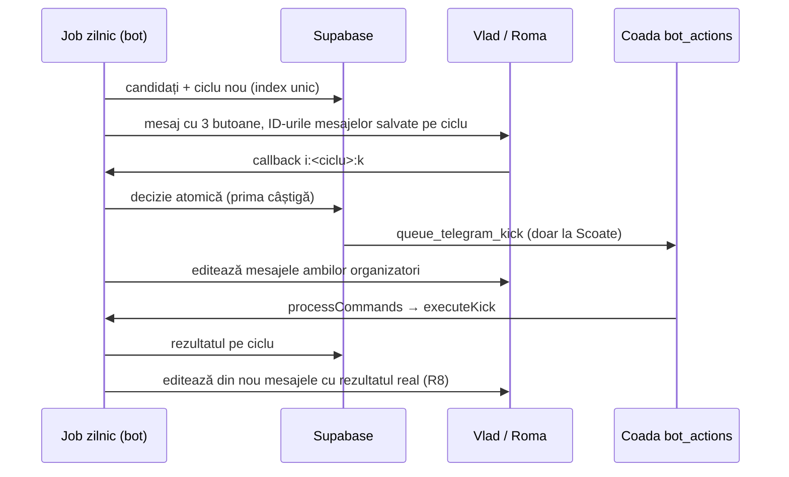

# Alertă de inactivitate cu acțiuni și istoric pe persoană în Probe - Plan

## Goal Capsule

- **Obiectiv:** organizatorii (Vlad și Roma) află la timp cine a dispărut din antrenamente și decid din Telegram, cu un singur tap, dacă persoana e scoasă, amânată sau păstrată; separat, pot vedea în admin drumul fiecărei persoane venite prin `/start`, cu ora fiecărei etape.
- **Mijloace:** cicluri de alertă ținute în baza de date, cu butoane fără stare în bot (KTD1, KTD4); jurnal de evenimente pentru probe scris de triggere (KTD7).
- **Autoritate:** Product Contract (R/F/AE) > Key Technical Decisions > unitățile. Ambele zone sunt în același plan la cererea lui Vlad.
- **Condiții de oprire:** o regulă din Product Contract care se dovedește imposibilă; o migrare care ar schimba comportamentul botului vechi în producție; orice scriere în `payments`.
- **Profil de execuție:** cod în `bot/`, `src/admin/sala/`, `supabase/sql/`; migrări aplicate live de agent (vezi U7), deploy prin merge în `main`.
- **Blocaje deschise:** niciunul.
- **Product Contract preservation:** neschimbat; cele două întrebări „Deferred to Planning” sunt rezolvate în KTD5 și KTD6 și scoase din listă.

---

## Product Contract

### Summary

Botul trimite lui Vlad și lui Roma câte un mesaj pentru fiecare membru care a trecut 3 săptămâni cu antrenamente fără niciun „Da”, cu butoanele Scoate din grup / Amână 1 săptămână / Nu scoate; alerta înlocuiește raportul de luni. Ecranul Probe din admin primește o cronologie pe persoană cu ora fiecărei etape a fluxului de la `/start`, plus @username-ul și numele din profilul Telegram.

### Problem Frame

Raportul de luni (`bot/src/jobs/inactivity-alert.ts`) listează absenții de 14+ zile, dar e doar informativ: scoaterea se face separat din admin, iar nimeni nu ține minte cui i s-a acordat deja o șansă. O pauză de antrenamente face ca toți să pară absenți.

Pentru probe, ecranul Probe arată doar etapa curentă și sursa linkului. Nu se vede când a apăsat cineva `/start`, cât a stat într-o etapă sau unde s-a oprit cel care a abandonat.

### Actors

- A1. Organizatorii — Vlad și Roma, conturile din `TELEGRAM_ADMIN_CHAT_IDS`; primesc alertele și acționează.
- A2. Membrul inactiv — subiectul alertei; nu primește niciun mesaj din partea acestei funcții.
- A3. Persoana în probă — cine a apăsat `/start`; evenimentele ei alimentează istoricul.

### Key Decisions

- **Un singur plan pentru ambele zone.** (session-settled: user-directed — ales în locul a două brainstormuri separate: Vlad a vrut ambele planificate împreună.)
- **Inactivitatea se măsoară în săptămâni cu antrenamente, nu în zile.** O pauză nu declanșează alerte. (session-settled: user-directed — ales în locul a 21 de zile calendaristice: după o pauză de 3 săptămâni toți ar apărea absenți.) Governs R1, R2.
- **„Nu scoate” resetează numărătoarea, nu scutește definitiv.** (session-settled: user-directed — ales în locul scutirii permanente anulabile din admin și al amânării cu durată la alegere.) Governs R7.
- **Alerta înlocuiește raportul de luni.** (session-settled: user-approved — recomandat în locul păstrării ambelor: o singură sursă, mai puține mesaje.) Governs R10.
- **Identitatea din probe e cea de Telegram, nu de Instagram.** Telegram nu transmite nimic despre contul de Instagram din care vine persoana; nickul de Instagram ar cere integrarea Meta. (session-settled: user-directed — după ce Vlad a clarificat că se referea la datele pe care botul le vede la `/start`.) Governs R13.
- **Doar istoric în admin, fără notificări la fiecare etapă.** (session-settled: user-directed — ales în locul istoric + mesaje către organizatori și al doar mesaje.) Governs R12.

### Requirements

**Detectarea inactivității**

- R1. Un membru activ din grup intră în alertă când nu are niciun „Da” în ultimele 3 săptămâni care au avut cel puțin un antrenament programat.
- R2. O săptămână fără niciun antrenament programat (toate anulate sau niciunul) nu se numără; numărătoarea continuă după pauză de unde a rămas.
- R3. Un membru care n-a dat niciodată „Da” se socotește de la data intrării în grup, după aceeași regulă.
- R4. Organizatorii și administratorii Telegram nu primesc niciodată alertă.
- R5. Verificarea rulează zilnic dimineața; fiecare membru primește o singură alertă pe ciclu de inactivitate, nu una pe zi.

**Alerta și acțiunile**

- R6. Fiecare membru inactiv primește un mesaj propriu, trimis fiecărui organizator, cu numele, @username-ul, data ultimului „Da” (sau „niciodată”) și numărul de săptămâni cu antrenamente lipsite, plus trei butoane: Scoate din grup, Amână 1 săptămână, Nu scoate.
- R7. „Amână 1 săptămână” suspendă alerta pentru 7 zile; dacă membrul tot n-a dat „Da” după aceea, alerta revine. „Nu scoate” închide ciclul: o nouă alertă apare doar după alte 3 săptămâni cu antrenamente fără „Da”, numărate de la decizie.
- R8. „Scoate din grup” folosește scoaterea existentă (scos, poate fi invitat din nou, istoricul rămâne) și raportează rezultatul real în mesaj.
- R9. Prima decizie câștigă: după ce un organizator apasă un buton, mesajul ambilor organizatori se actualizează cu decizia, cine a luat-o și când, iar butoanele dispar; un tap ulterior pe un mesaj vechi nu mai are efect.
- R10. Raportul săptămânal de luni dispare.
- R11. „Scoate din grup” este refuzat dacă membrul a dat „Da” după trimiterea alertei sau nu mai e în grup; mesajul explică motivul și ciclul se închide.

**Istoricul probelor**

- R12. Fiecare persoană din ecranul Probe are o cronologie cu data și ora fiecărui eveniment din fluxul ei: a apăsat `/start` (cu sursa linkului), și-a scris numele, a pus o întrebare, a ales sau a schimbat proba, a anulat, a fost marcată prezentă sau absentă, a răspuns la continuare, a primit invitația, a intrat în grup, a ieșit sau a fost închisă, a oprit sau a repornit mesajele botului.
- R13. Lângă cronologie apar @username-ul de Telegram și numele din profilul Telegram, actualizate la fiecare interacțiune cu botul, separat de numele scris de persoană în bot.
- R14. Pentru persoanele dinainte de lansare, cronologia arată doar ce se poate deduce sigur (data `/start`, etapa curentă) și marchează că istoricul complet începe de la lansare.

### Key Flows

- F1. Alertă și decizie
  - **Trigger:** verificarea de dimineață găsește un membru care îndeplinește R1–R3.
  - **Actors:** A1, A2
  - **Steps:** botul trimite mesajul R6 lui Vlad și lui Roma; un organizator apasă un buton; acțiunea se execută; ambele mesaje se actualizează (R9).
  - **Outcome:** membru scos, amânat 7 zile sau păstrat cu numărătoarea resetată.
  - **Covered by:** R1–R9, R11
- F2. Urmărirea unei probe
  - **Trigger:** o persoană apasă `/start`.
  - **Actors:** A3, A1
  - **Steps:** fiecare pas din flux adaugă un eveniment; organizatorul deschide persoana în Probe și vede cronologia.
  - **Covered by:** R12–R14

### Acceptance Examples

- AE1. **Covers R2.** Given Ion a dat ultimul „Da” acum 5 săptămâni, iar 2 din cele 5 săptămâni n-au avut antrenamente, when rulează verificarea, then Ion are 3 săptămâni lipsite și primește alerta.
- AE2. **Covers R2.** Given Ion a dat ultimul „Da” acum 4 săptămâni și 2 dintre ele au fost pauză, when rulează verificarea, then nu primește alertă.
- AE3. **Covers R7.** Given Roma apasă „Amână 1 săptămână” pentru Ion, when în următoarele 7 zile Ion nu dă „Da”, then ziua a 8-a aduce o nouă alertă; if Ion dă „Da” între timp, then nu vine nicio alertă.
- AE4. **Covers R7.** Given Vlad apasă „Nu scoate” pentru Ion, when Ion nu mai vine nici în următoarele 2 săptămâni cu antrenamente, then nu primește alertă; after a 3-a săptămână fără „Da”, alerta revine.
- AE5. **Covers R9.** Given Vlad a apăsat „Scoate din grup”, when Roma apasă „Amână” pe mesajul lui, then nu se întâmplă nimic în plus, iar mesajul lui Roma arată „Scos de Vlad, <ora>”.
- AE6. **Covers R11.** Given alerta pentru Ion a plecat luni, iar marți Ion dă „Da”, when Vlad apasă „Scoate din grup” miercuri, then scoaterea e refuzată cu motivul „a confirmat un antrenament după alertă”.
- AE7. **Covers R3, R4.** Given Maria a intrat în grup acum 2 săptămâni și n-a dat niciodată „Da”, when rulează verificarea, then nu primește alertă încă; Roma, organizator, nu apare niciodată.

### Scope Boundaries

- Notificări către organizatori la fiecare etapă a probei — Vlad a ales doar istoricul în admin.
- Nickul de Instagram și integrarea cu API-ul Instagram (aplicație Meta, cont Business) — rămân pentru un plan separat.
- Mesaje automate către membrul inactiv („ne e dor de tine”).
- Scutire permanentă de alertă și amânări cu durată la alegere.
- Reconstituirea istoricului complet pentru probele dinainte de lansare.

### Dependencies / Assumptions

- „Nu vine” înseamnă „nu a dat «Da» în sondaj”, inclusiv corecturile de prezență făcute din admin: nu există altă evidență a prezenței reale (`member_attendance_stats.last_attended` derivă din `attendance.response = 'yes'`).
- Săptămâna e săptămâna calendaristică în fusul orar al botului.
- Roma trebuie să fie în `TELEGRAM_ADMIN_CHAT_IDS` ca să primească alertele; setarea e încă nefăcută (în așteptarea confirmării lui Vlad).

### Sources / Research

- `bot/src/jobs/inactivity-alert.ts` — raportul de luni care se înlocuiește; programat în `bot/src/index.ts`.
- `bot/src/lib/kick-member.ts` — scoaterea existentă (ban + unban, protecție pentru organizatori și administratori).
- `bot/src/lib/organizers.ts`, `bot/src/lib/notify.ts` — destinatarii organizatori.
- `bot/src/lib/telegram.ts` — `sendMessage`, `editMessageText`, `answerCallbackQuery` există deja.
- `bot/src/lib/trial.ts`, `supabase/schema/sala.sql` (`trial_prospects`, `trial_bookings`) — etapele actuale ale probei și locurile unde se schimbă.
- `src/admin/sala/EcranProbe.tsx` — ecranul care primește cronologia.
- [Meta: Instagram User Profile API](https://developers.facebook.com/docs/instagram-platform/instagram-api-with-instagram-login/messaging-api/user-profile) — ce date oferă Instagram, pentru planul ulterior.

---

## Planning Contract

### Key Technical Decisions

- KTD1. **Un ciclu de alertă e un rând în baza de date, nu stare în memoria botului.** Tabel nou în `public` (o înregistrare pe ciclu: membru, data de referință, săptămâni lipsite, stare, amânare până la, cine a decis și când, rezultat, legătura cu acțiunea de scoatere, mesajele trimise fiecărui organizator). Un index unic parțial permite un singur ciclu activ pe membru. Motiv: alertele trăiesc zile întregi și trebuie să supraviețuiască restarturilor Railway; `MemberControl` ține alegerile în memorie 15 minute, ceea ce aici nu ajunge. Governs R5, R7, R9.
- KTD2. **Numărătoarea săptămânilor se face într-o funcție SQL.** Referința unui membru este cea mai recentă dintre: data ultimului „Da” (`member_attendance_stats.last_attended`), `members.join_date` și data ultimei decizii „Nu scoate”. Se numără săptămânile calendaristice (luni–duminică) de după săptămâna referinței care au cel puțin un antrenament neanulat cu data strict înaintea zilei verificării. Candidații vin din `telegram_training_stats` (activi, cu Telegram, care nu au ieșit și nu au fost scoși), fără `is_admin`; botul mai exclude și ID-urile din `TELEGRAM_ADMIN_CHAT_IDS`. Motiv: logica se testează determinist pe instantaneu (pglite), ca restul regulilor din `sala`. Implements R1–R4 (session-settled: Key Decision „săptămâni cu antrenamente”).
- KTD3. **„A revenit” înseamnă o săptămână de referință nouă.** Un ciclu deschis sau amânat se închide ca „a revenit” când `last_attended` trece de data de referință a ciclului; aceeași condiție refuză „Scoate” (R11). Un „Da” pentru un antrenament viitor contează și el: persoana a confirmat că vine. Governs R7, R11.
- KTD4. **Butoanele poartă ID-ul ciclului (`i:<ciclu>:<k|p|n>`, sub 64 de octeți), iar decizia o ia o funcție SQL atomică.** Funcția blochează rândul, acceptă doar un ciclu deschis, verifică R11 și starea de apartenență și înregistrează decizia. Pentru „Scoate” cheamă `queue_telegram_kick` și păstrează ID-ul acțiunii. Un tap pe un ciclu deja decis întoarce decizia existentă (R9, AE5). Autorizarea organizatorului rămâne în bot, ca la prefixele `m:`/`c:` din `bot/src/webhook.ts`.
- KTD5. **Rularea e zilnică, prima dată după 09:00 ora sălii, cu protecție la repetare.** Tick-ul de un minut din `bot/src/index.ts` pornește jobul când ora e ≥ 09:00 și nu a mai rulat azi în proces. Indexul unic din KTD1 face o rulare dublă inofensivă, iar un restart după 09:00 nu pierde ziua. Tot sub comutatorul `bot_config.enabled`, ca raportul vechi. Rezolvă întrebarea despre oră.
- KTD6. **Mesajele pleacă secvențial, câte unul pe ciclu și pe organizator, fără grupare.** Grupul are câteva zeci de membri; după prima rulare, alertele apar câte una-două pe zi. Dacă niciun mesaj al unui ciclu nu pleacă, ciclul se șterge și se reîncearcă la rularea următoare. Rezolvă întrebarea despre grupare.
- KTD7. **Evenimentele probelor se scriu cu triggere AFTER pe tabelele `trial_*`, într-un jurnal nou.** Decizia îi aparține agentului, la cererea lui Vlad. Triggerele prind fiecare drum: codul botului, funcțiile `trial_*` și RPC-urile din admin. Altfel, fiecare dintre aproximativ 15 locuri de scriere ar trebui să-și amintească să scrie evenimentul. Ce se pierde: o reprogramare apare ca „anulat” urmat de „programat”. Triggerele nu înghit erorile, ca un jurnal stricat să fie văzut imediat în teste, nu să lipsească pe tăcute. Governs R12.
- KTD8. **Profilul Telegram se salvează pe persoana în probă.** Coloane noi, nullabile, pentru prenumele și numele din profil, actualizate împreună cu username-ul la fiecare actualizare privată a persoanei, doar când s-au schimbat. Upsert-ul de la `/start` din `bot/src/lib/trial.ts` nu mai ignoră aceste câmpuri la o persoană existentă. Governs R13.
- KTD9. **Istoricul vechi se marchează, nu se inventează.** Migrarea adaugă pentru fiecare persoană existentă un eveniment „a pornit botul” la `created_at`, marcat ca reconstituit; ecranul afișează nota din R14 când există un astfel de eveniment. Governs R14.

### High-Level Technical Design

Ciclul de alertă (stările din KTD1). Diagrama arată direcția, nu numele exacte:

Fluxul unei decizii (cine scrie ce):

### Implementation Constraints

- Migrările nu schimbă coloanele, constrângerile sau funcțiile existente folosite de botul vechi. Doar adaugă: tabele, coloane nullabile, triggere și funcții noi. `admin_trial_data` primește o cheie nouă.
- Tabelele noi au RLS activ fără politici și drepturile revocate pentru `anon`/`authenticated`. Funcțiile noi sunt `SECURITY DEFINER` cu `search_path ''`, executabile doar de `service_role`, ca `queue_telegram_kick`.
- Fișiere SQL noi în `supabase/sql/`, adăugate în `MIGRARI_NEAPLICATE` din `tests/unit/sql/db.ts` până la regenerarea instantaneelor.

---

## Implementation Units

### U1. Ciclurile de alertă în baza de date

**Goal:** tabelul de cicluri, funcția de candidați și funcția de decizie.

**Requirements:** R1–R4, R7, R9, R11; KTD1–KTD4.

**Dependencies:** —

**Files:**
- `supabase/sql/supabase-migration-sala-inactivitate.sql` (nou)
- `tests/unit/sql/inactivitate.test.ts` (nou)
- `tests/unit/sql/db.ts` (`MIGRARI_NEAPLICATE`)
- `tests/unit/sql/drepturi.test.ts` (lista funcțiilor și drepturile lor)

**Approach:**
1. Tabelul de cicluri, cu stările din diagrama ciclului, indexul unic parțial pe membru pentru stările active (deschis, amânat, scoatere în coadă) și lista de mesaje (chat + ID mesaj).
2. Funcția de candidați primește ziua de azi și întoarce membrul, referința, săptămânile lipsite, ultimul „Da” și data intrării, pentru membrii fără ciclu activ (KTD2).
3. Funcția de deschidere inserează ciclul. Un conflict pe index înseamnă „există deja” și nu e eroare.
4. Funcția de decizie primește ciclul, acțiunea, organizatorul și grupul, apoi întoarce rezultatul și starea curentă (KTD4). „Amână” setează termenul la acum + 7 zile; „Nu scoate” devine referința următoare (KTD2).
5. Funcția de întreținere închide ca „a revenit” sau „a ieșit” ciclurile deschise sau amânate a căror condiție s-a schimbat și redeschide ciclurile amânate expirate (KTD3). Ciclurile cu scoatere în coadă nu se ating: rezultatul lor îl scrie U4. Întoarce ciclurile atinse, ca botul să le editeze mesajele.

**Patterns to follow:** `queue_telegram_kick` și `record_telegram_membership` din `supabase/schema/sala.sql` (blocare, erori cu nume, drepturi); `tests/unit/sql/sala.test.ts` (fixturi pentru membri și antrenamente).

**Test scenarios:**
- Covers AE1. Ultimul „Da” acum 5 săptămâni, 2 săptămâni fără antrenamente → membrul apare cu 3 săptămâni lipsite.
- Covers AE2. Ultimul „Da” acum 4 săptămâni, 2 de pauză → nu apare.
- O săptămână cu un singur antrenament, anulat, nu se numără.
- Un antrenament de azi sau din viitor nu se numără.
- Covers AE7. Membru intrat acum 2 săptămâni, fără „Da” → nu apare; un `is_admin` nu apare niciodată.
- Un membru care a ieșit sau a fost scos (apartenență `left`/`kicked`) nu apare.
- Covers AE4. După „Nu scoate”, 2 săptămâni cu antrenamente fără „Da” → nu apare; la a 3-a → apare.
- Un membru cu ciclu deschis nu reapare în candidați; o deschidere dublă nu creează al doilea ciclu.
- Covers AE5. Două decizii pe același ciclu → prima se aplică, a doua întoarce decizia existentă fără efect.
- Covers AE6. „Scoate” după un „Da” mai nou decât referința → refuzat, fără rând în `bot_actions`.
- „Scoate” valid → un singur rând `kick_member` în coadă, legat de ciclu.
- Covers AE3. Ciclu amânat cu termen trecut și fără „Da” → redeschis de întreținere; cu „Da” → închis ca „a revenit”.
- `anon` și `authenticated` nu pot citi tabelul și nu pot executa funcțiile.

**Verification:** testele SQL trec pe instantaneu plus migrare; `drepturi.test.ts` acoperă funcțiile noi.

### U2. Jurnalul evenimentelor de probă

**Goal:** evenimentele scrise de triggere, profilul Telegram pe persoana în probă și evenimentele în `admin_trial_data`.

**Requirements:** R12–R14; KTD7–KTD9.

**Dependencies:** —

**Files:**
- `supabase/sql/supabase-migration-sala-istoric-probe.sql` (nou)
- `tests/unit/sql/probe.test.ts`
- `tests/unit/sql/db.ts`
- `tests/unit/sql/drepturi.test.ts`

**Approach:**
1. Tabelul de evenimente: persoana, tipul, momentul, detalii JSON, marcajul „reconstituit”, plus un index pe persoană și moment.
2. Triggerele, care urmează un singur model:

   | Sursă | Schimbare | Eveniment |
   |---|---|---|
   | `trial_prospects` | inserare | a pornit botul (cu sursa linkului) |
   | `trial_prospects` | numele completat sau schimbat | și-a scris numele |
   | `trial_prospects` | `dm_enabled` comutat | a oprit / a repornit mesajele |
   | `trial_prospects` | etapa devine `in_group` / `closed` | a intrat în grup / închis |
   | `trial_bookings` | inserare | a ales proba (data, locul) |
   | `trial_bookings` | status `cancelled` | probă anulată |
   | `trial_bookings` | status `attended` / `absent` | prezent / absent; „corectat” dacă exista deja `attendance_at` |
   | `trial_bookings` | `continuation` setat | vrea / nu vrea să continue |
   | `trial_questions` | inserare | a pus o întrebare |
   | `trial_messages` | `invite` trece în `sent` | a primit invitația |

3. Coloane nullabile pentru prenumele și numele din profilul Telegram pe `trial_prospects`. Actualizările lor nu produc evenimente.
4. Reconstituirea din KTD9.
5. `admin_trial_data` primește lista de evenimente, ordonată cronologic.

**Patterns to follow:** funcțiile `trial_*` din `supabase/schema/sala.sql`; testele din `tests/unit/sql/probe.test.ts`, care trec prin funcțiile reale (`trial_book`, `trial_set_attendance`, `trial_continue`, `trial_complete_message`, `trial_convert`).

**Test scenarios:**
- Fluxul complet prin funcțiile reale (inserare persoană → nume → `trial_book` → `trial_set_attendance` prezent → `trial_continue` da → invitație trimisă → `trial_convert`) produce evenimentele în ordine, cu tipurile din tabel.
- O corectare a prezenței produce „corectat”, nu un al doilea „prezent”.
- `trial_cancel` urmat de `trial_book` produce „anulat”, apoi „a ales proba”.
- Comutarea `dm_enabled` de două ori produce oprit + repornit; o actualizare doar de profil nu produce niciun eveniment.
- Un mesaj care nu e `invite`, trecut în `sent`, nu produce eveniment.
- Reconstituirea: o persoană existentă înainte de migrare primește exact un eveniment marcat, iar rularea migrării a doua oară nu-l dublează.
- `admin_trial_data` întoarce evenimentele și nu expune tokenul; `anon` nu citește tabelul de evenimente.

**Verification:** testele de probă existente trec neschimbate, iar cele noi trec.

### U3. Jobul zilnic de inactivitate

**Goal:** înlocuiește raportul de luni cu jobul care deschide, redeschide și închide cicluri și trimite sau editează mesajele.

**Requirements:** R5, R6, R10, F1; KTD5, KTD6.

**Dependencies:** U1

**Files:**
- `bot/src/jobs/inactivity-alert.ts` (rescris; păstrează exportul `inactivityAlert`)
- `bot/src/lib/inactivity-text.ts` (nou: textele și tastatura)
- `bot/src/index.ts`
- `bot/test/inactivity.test.ts` (nou)

**Approach:**
1. Jobul primește porturile injectate: baza de date, trimitere, editare, organizatori, ziua de azi.
2. Întâi întreținerea: editează mesajele ciclurilor închise ca „a revenit” / „nu mai e în grup” și retrimite mesajele ciclurilor redeschise.
3. Apoi candidații. Pentru fiecare, întâi o verificare live `getChatMember` (R4): `administrator`/`creator` → sărit; ieșit sau scos → starea se înregistrează (`recordMembership`) și candidatul e sărit; dacă verificarea eșuează, candidatul se amână la rularea următoare. Altfel: ciclu nou, mesaj la fiecare organizator, ID-urile salvate. Fără niciun mesaj trimis, ciclul se șterge (KTD6).
4. Textul R6: numele, @username sau „fără @utilizator”, „Ultimul «Da»: <dată>” sau „niciodată (în grup din <dată>)”, „<n> săptămâni cu antrenamente fără «Da»”.
5. În `bot/src/index.ts`: condiția zilnică din KTD5 înlocuiește blocul `weekday === 1 && hhmm === "09:00"`.

**Patterns to follow:** porturile injectate din `bot/src/lib/kick-member.ts` și `bot/src/jobs/day-ops.ts`; textele din `bot/src/lib/poll-text.ts`; `fmtDate` din `bot/src/lib/format.ts`.

**Test scenarios:**
- Un candidat și doi organizatori → două mesaje cu trei butoane `i:<ciclu>:k|p|n` și două ID-uri salvate pe ciclu.
- Un membru fără „Da” → textul spune „niciodată” și data intrării.
- Un organizator nu primește alertă despre sine chiar dacă e candidat în baza de date.
- Un candidat care e administrator Telegram al grupului (verificare live) → sărit, fără ciclu.
- Un candidat care a ieșit între timp → apartenența se înregistrează, fără ciclu.
- Verificarea live eșuează → fără ciclu azi, reîncercat mâine.
- Trimiterea eșuează la toți organizatorii → ciclul se șterge; la unul singur → ciclul rămâne cu un mesaj.
- Ciclu închis ca „a revenit” → ambele mesaje editate, fără butoane.
- Ciclu redeschis după amânare → mesaje noi trimise, iar lista de mesaje e înlocuită.
- Programarea: la 08:59 nu rulează, la 09:00 rulează, la 09:01 nu mai rulează în aceeași zi; după un restart la 10:00 rulează o dată.

**Verification:** `bot/test/inactivity.test.ts` trece; vechiul raport de luni nu mai e programat nicăieri.

### U4. Butoanele și rezultatul scoaterii

**Goal:** callback-ul `i:` decide, editează mesajele ambilor organizatori și raportează rezultatul real al scoaterii.

**Requirements:** R7–R9, R11, AE3–AE6; KTD3, KTD4.

**Dependencies:** U1, U3

**Files:**
- `bot/src/inactivity-control.ts` (nou)
- `bot/src/webhook.ts` (ruta `i:`)
- `bot/src/jobs/process-commands.ts`
- `bot/test/inactivity.test.ts`

**Approach:**
1. `answerCallbackQuery` imediat; doar chat privat și organizatori, ca la `m:`.
2. Funcția de decizie din U1, apoi editarea tuturor mesajelor ciclului cu textul deciziei: „Amânat de Roma până pe <dată>”, „Păstrat de Vlad”, „Scoatere cerută de Vlad, <ora> — se execută…”, „Refuzat: a confirmat un antrenament după alertă”.
3. Un tap pe un ciclu deja decis primește în toast decizia existentă și nu schimbă nimic.
4. În `processCommands`, după `executeKick`, dacă acțiunea aparține unui ciclu: rezultatul se scrie pe ciclu și mesajele se editează cu „Scos de Vlad” sau „Scoaterea a eșuat: <motiv>”. Mesajul separat către organizator e omis, pentru că mesajele editate îl conțin.

**Patterns to follow:** `bot/src/member-control.ts` (dependențe injectate, verificarea organizatorului); `editMessageText` din `bot/src/lib/telegram.ts`.

**Test scenarios:**
- Covers AE5. Vlad apasă Scoate, apoi Roma apasă Amână → o singură decizie; mesajul lui Roma arată „Scoatere cerută de Vlad”, iar după executare „Scos de Vlad, <ora>”.
- Covers AE3. Amână → ambele mesaje editate cu data termenului, fără butoane.
- Covers AE6. Scoate refuzat → text cu motivul, fără acțiune în coadă.
- Un non-organizator sau un callback din grup → ignorat, fără apel la baza de date.
- Un callback cu un ID de ciclu inexistent → toast „Alerta nu mai există”, fără eroare 500.
- Rezultatul scoaterii: reușită → ciclu „scos” și mesaje editate; eșec (de exemplu „Organizatorii nu pot fi scoși.”) → ciclu „scoatere eșuată” cu motivul.
- O acțiune `kick_member` fără ciclu (din admin sau `/scoate`) → comportamentul de azi neschimbat, cu mesajul către organizator.
- Editarea unui mesaj șters de organizator eșuează → decizia rămâne salvată, iar eroarea doar se loghează.

**Verification:** testele botului trec; o decizie se vede pe ambele mesaje.

### U5. Profilul Telegram al persoanelor în probă

**Goal:** username-ul și numele din profil rămân la zi.

**Requirements:** R13; KTD8.

**Dependencies:** U2

**Files:**
- `bot/src/lib/trial.ts`
- `bot/test/trial.test.ts`

**Approach:** la `/start`, inserarea include profilul. La o persoană existentă, orice mesaj privat sau callback al ei actualizează username-ul, prenumele și numele, doar dacă diferă de cele salvate.

**Patterns to follow:** dublurile `TrialDb` din `bot/test/trial.test.ts`.

**Test scenarios:**
- O persoană nouă la `/start` → rândul are username-ul și numele din profil.
- O persoană existentă care și-a schimbat @username-ul trimite un mesaj → username actualizat.
- Un profil neschimbat → nicio scriere.
- O persoană fără @username → username null, fără eroare.

**Verification:** testele de probă ale botului trec.

### U6. Cronologia în ecranul Probe

**Goal:** detaliul persoanei arată profilul Telegram și cronologia evenimentelor.

**Requirements:** R12–R14, F2.

**Dependencies:** U2

**Files:**
- `src/lib/trialApi.ts`
- `src/admin/sala/EcranProbe.tsx`
- `src/admin/sala/probe.css`
- `tests/unit/trialUi.test.tsx`
- `tests/trial.spec.ts` (fixturile primesc `events`)

**Approach:**
1. Tipul evenimentului și lista în `TrialData`; lipsa listei e tratată ca listă goală, ca adminul nou să meargă și înaintea migrării.
2. Sub titlul persoanei: „Telegram: @user · <prenume nume>”.
3. Secțiunea „Cronologie”, deasupra probelor: fiecare eveniment cu `ziLunaOra` și eticheta în română, din același tip de dicționar ca `TRIAL_STAGE`.
4. Nota R14 când primul eveniment e reconstituit.

**Patterns to follow:** secțiunea „Istoricul mesajelor” din același ecran; clasele `admin-probe-item`.

**Test scenarios:**
- O persoană cu evenimente în ordine → cronologia le arată cu ora și eticheta corectă.
- Un eveniment de tip necunoscut → afișat cu tipul brut, fără crash.
- Un eveniment reconstituit → nota „istoricul complet începe de la lansare”.
- Date fără cheia `events` → ecranul se încarcă, iar cronologia lipsește.
- Profil fără @username → „Telegram <id>”.

**Verification:** `trialUi.test.tsx` trece, iar e2e-ul de probă trece cu fixturile actualizate.

### U7. Lansarea și documentația

**Goal:** migrările aplicate live, instantaneele regenerate și ghidurile actualizate.

**Requirements:** toate (livrare).

**Dependencies:** U1–U6

**Files:**
- `supabase/schema/sala.sql`
- `supabase/schema/runlift.sql`
- `tests/unit/sql/db.ts`
- `MIGRATIONS.md`
- `bot/README.md`
- `docs/features/antrenament-proba.md`

**Approach:**
1. Ordinea:
   1. Aplicarea celor două migrări prin MCP `apply_migration` (`sala_07_inactivitate`, `sala_08_istoric_probe`), compatibile cu botul vechi.
   2. Verificarea live cu interogări (candidații de azi, reconstituirea, un trigger pe o tranzacție anulată).
   3. Regenerarea instantaneelor cu `scripts/schema-snapshot-sala.sql` și ieșirea migrărilor din `MIGRARI_NEAPLICATE`.
   4. Merge-ul livrează botul (Railway) și adminul (Vercel).
2. După deploy: `/health` și ziua următoare la 09:00, cu alertele reale.
3. Documentația: o intrare în `MIGRATIONS.md`, o secțiune scurtă în `bot/README.md` (alerta zilnică, butoanele, că raportul de luni a dispărut) și cronologia în ghidul probelor.

**Test expectation:** none — lansare și documentație; comportamentul e acoperit în U1–U6, iar verificarea live e descrisă mai sus.

**Verification:** `list_migrations` arată ambele migrări; instantaneele conțin exact migrările; `MIGRARI_NEAPLICATE` e gol.

---

## Verification Contract

| Poartă | Comandă | Când |
|---|---|---|
| Teste bot | `npm test` în `bot/` | U3, U4, U5 |
| Tipuri bot | `npm run build` în `bot/` | U3, U4, U5 |
| Teste SQL și UI | `npm test` (vitest, include `tests/unit/sql/`) | U1, U2, U6 |
| Lint, tipuri, cod mort | `npm run lint`, `npm run deadcode`, `npm run typecheck`, `npm run typecheck:tests` | înainte de PR |
| E2E | `npm run test:e2e` pe serverul de dev (local); build-ul e acoperit de CI | U6 |
| Live | interogări după `apply_migration`, apoi prima rulare de la 09:00 | U7 |

---

## Definition of Done

- Toate R1–R14 sunt implementate, iar AE1–AE7 au teste care trec.
- Raportul de luni nu mai există în cod și nici în programare.
- Migrările sunt aplicate în producție, instantaneele regenerate, `MIGRARI_NEAPLICATE` e gol, iar `MIGRATIONS.md` și `bot/README.md` sunt actualizate.
- CI e verde pe PR; botul și adminul sunt live după merge.
- Nu rămân în diff cod abandonat, experimente sau logare de depanare.
