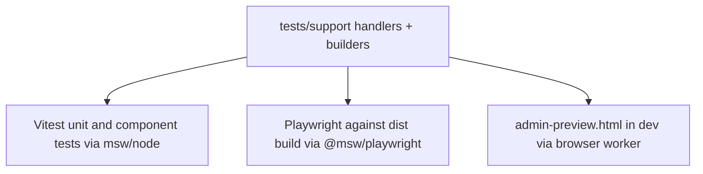
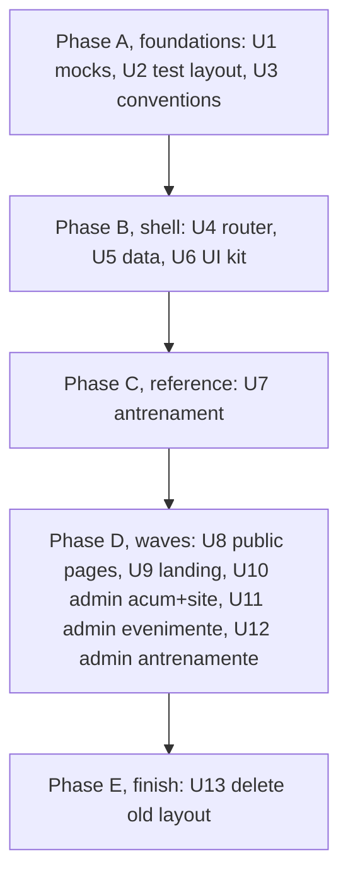

# Component architecture and test layers - Plan

## Goal Capsule

- **Objective:** Adding, changing, or removing a page, component, or element in the web app is a small change in one feature folder, and each behavior is covered by exactly one test at the right layer.
- **Means:** Keep the current stack and evolve it in place: shared test mocks first, then the app shell (router, data library, UI kit), `/antrenament` as the reference feature, one wave per area, and finally deletion of the old layout (KTD9, KTD1).
- **Authority:** The Product Contract owns what changes; the Planning Contract owns how. The standing decisions of `docs/plans/2026-09-05-refactor-mentenabilitate-si-acoperire.md` stay in force (edition config as source of truth, deliberate duplication left in place). The Telegram bot (`bot/`), Supabase edge functions, and SQL migrations are not active scope.
- **Stop conditions:** Stop and ask before changing any RPC name, request header, or payload shape; before changing rendered text or a visible style value; before adding a runtime dependency beyond those named in KTD2 and KTD4; and if the U1 spike shows MSW 3 cannot serve Playwright against the production build and the fallback adapter also fails.
- **Execution profile:** One PR per unit, each merged to `main` through CI before the next unit that depends on it starts. Units U8 to U12 must not run in parallel with feature branches touching the same area (R18).
- **Open blockers:** None. The current feature branch `feat/alerta-inactivitate-istoric-probe` must merge before U1 starts moving files.

---

## Product Contract

### Summary

Write an architecture map for the web app and its tests, then migrate to it in shippable steps. Code is grouped by feature; pages are declared in one typed router with on-demand loading; shared UI lives in one kit with component-scoped styles on the existing brand tokens; server state goes through one data library; tests follow a written layer rule and share one set of Supabase mocks and data builders.

### Problem Frame

Literal copy-paste is already low: jscpd measured 1.2% duplication (85 clones, ~860 of ~72k lines) on 2026-10-12, and the 2026-09-05 refactor added `oxlint`, `knip`, and a coverage floor. The cost now is structural.

- **Pages have no single home.** `src/main.tsx` routes with a hand-written ternary chain over `window.location.pathname`; each page also needs a rewrite in `vercel.json`, and the `/antrenament` share card needs a second HTML entry in `vite.config.ts`. Nothing is lazy-loaded, so `/admin` code ships to every public visitor.
- **Styles have global reach.** About 1,350 class rules live in `src/index.css` (2,638 lines), `src/public.css`, and `src/edition3.css`, all global; 14 files also use inline `style={{}}`. A change to one element can affect any page. The `--e3-*` tokens in `src/index.css` are the one part that already works as a single source.
- **Two component worlds.** Admin primitives live in `src/admin/controale/`; public ones in `src/components/landing/shared.ts`. The admin screen registry in `src/admin/adminNavigatie.ts` is the one place where adding a screen is already one entry plus a component.
- **Server state is hand-rolled.** `src/lib/adminApi.ts` (908 lines, 67 exports), `src/lib/supabase.ts`, `src/lib/salaApi.ts`, plus `useAdminResource` and `useAdminPolling` reimplement loading, abort, and polling.
- **Tests mock the backend separately everywhere.** 14 unit test files stub `fetch` on their own, and all 18 Playwright specs mock Supabase with their own `page.route` handlers and data. The same flows are often asserted in both layers.

The user gave no single painful incident; the stated goal is that adding, changing, or removing components, elements, and pages stays easy as the app grows.

### Key Decisions

- **Evolve in place, not a framework move or UI rebuild.** Keeps every step shippable and the site never broken. (session-settled: user-approved — chosen over migrating to React Router 7 framework mode / Next.js and over a full Tailwind + component-library restyle: lower one-time cost, no deploy or CSP rework, no restyle of the custom brand.) Governs R4, R8, R19.
- **Foundations, one reference feature, then waves with an end state.** The only option that ends with one structure without an unreviewable diff. (session-settled: user-approved — chosen over a big-bang restructure in one branch and over migrate-on-touch, which leaves two layouts indefinitely.) Governs R15, R16, R17.
- **Coverage is the web app and its tests.** (session-settled: user-approved — chosen over whole-repo restructure including `bot/` and edge functions, and over public-site-only.) Governs R1.
- **Test foundations come first.** The shared mock layer is the safety net for every later file move. Governs R15.
- **Recommended stack additions:** TanStack Router (typed routes and search params, code-split pages; React Router 7 data mode is the fallback), TanStack Query for server state, CSS Modules over the existing tokens (native in Vite, no restyle; Tailwind rejected for this reason), MSW for shared Supabase mocks. Vitest, Testing Library, Playwright, PGlite, oxlint, and knip stay. (session-settled: user-approved — proposed with alternatives named; the user confirmed.) Governs R4, R8, R10, R12.
- **No visible change is the default.** The user did not name invariants; the confirmed synthesis assumed URLs, look, network calls, and deploy flow stay the same. Governs R5, R19.

### Requirements

**Architecture map**

- R1. A written architecture map defines the target layout for `src/` and `tests/`: app shell, features, shared UI kit, shared libraries, and where a new page, component, style, data call, and test go.
- R2. Each feature owns its pages, components, styles, data access, and tests in one place, and may not import another feature's internals; CI fails on a violation.
- R3. Adding a page means adding a feature folder (or a page inside one) and one route declaration; removing a page means deleting both, with no edits to other features.

**Routing**

- R4. All pages, public and admin, are declared in one typed router that replaces the `src/main.tsx` path chain.
- R5. Every current URL, the `?preview=` parameter, and every saved admin hash address such as `#livrare` keeps working.
- R6. Pages other than the landing load on demand, so the public landing bundle contains no admin code.

**UI and styling**

- R7. A shared UI kit holds every primitive used by more than one feature, merging the overlapping pieces of `src/admin/controale/` and `src/components/landing/shared.ts`.
- R8. Each component's styles are scoped to that component; global CSS shrinks to tokens, reset, and base typography.
- R9. The `--e3-*` tokens remain the single source for colors, and inline style objects are used only for values computed at runtime.

**Data**

- R10. Loading, error, abort, polling, and refetch-after-save for Supabase data go through one data library; feature code does not hand-roll them, and an invalid admin token is handled in one place.

**Tests**

- R11. A written test-layer rule assigns each kind of behavior to one layer: pure logic to unit tests, component behavior to component tests, critical user journeys and build-only concerns (routing, rewrites, CSP, the share card) to Playwright, SQL and RPC rules to PGlite tests.
- R12. One shared set of Supabase mocks and data builders serves unit, component, and Playwright tests; no test file defines its own backend mock.
- R13. A test that asserts a behavior owned by another layer under R11 is removed, after confirming the owning layer covers it.
- R14. The coverage floor in `vitest.config.ts` is re-baselined once, deliberately, after duplicate tests are removed, and never lowered silently after that.

**Migration**

- R15. Work runs in this order: test foundations, router and app shell, UI kit with scoped styles and the data library, one reference feature migrated end to end, remaining features in waves, deletion of the old layout.
- R16. Each step ships as its own PR to `main` through the existing CI, and the site works after every merge.
- R17. The migration ends with no code left in the old layout, and lint blocks reintroducing it.
- R18. A wave does not run while an open feature branch touches the same area; open feature branches merge first.

**Behavior preservation**

- R19. Rendered text, visual appearance, network calls (URLs, headers, RPC names, payloads), and the deploy-on-merge flow do not change; `tests/unit/backend-contract.test.ts` passes unmodified.

### Acceptance Examples

- AE1. **Covers R3, R4.** **Given** the migration is done, **when** a developer adds a public page `/program`, **then** the diff is one new folder plus one route declaration, plus a deploy rewrite only if the deploy setup still needs per-page entries.
- AE2. **Covers R5.** **Given** an organizer's bookmark to `/admin#livrare`, **when** they open it after the router lands, **then** the same delivery screen opens.
- AE3. **Covers R5, R6.** **Given** a visitor opens `/?preview=soon`, **when** the page loads, **then** Coming Soon shows as before and no admin code is downloaded.
- AE4. **Covers R12, R13.** **Given** the registration flow is covered by a component test and a Playwright spec asserting the same validation messages, **when** R13 is applied, **then** the validation assertions remain only in the component test and the Playwright spec keeps only the end-to-end signup journey.

### Success Criteria

- Duplication measured by jscpd stays at or below 1.2%.
- No file under `tests/` stubs `fetch` or routes Supabase requests outside the shared mock module.
- `npm run verify` passes after every step, and Playwright run time does not grow.

<!-- ce-section: work-relationships -->
### How This Work Fits Together

This plan covers the web app (`src/`) and its tests (`tests/`), including the routing, UI kit, styling, data, and test-layer work as migration waves. The breakdown below is the current understanding, not a committed roadmap.

- The Telegram bot (`bot/`): can proceed independently of this plan; still to decide whether it adopts the shared test-layer rule and mock builders later.
- Supabase edge functions and SQL tests: can proceed independently; share the R11 layer rule for SQL and RPC tests.
- Shared validation schemas between forms and API parsing: depends on R10; still to decide.

### Scope Boundaries

- Restructuring `bot/`, `supabase/functions/`, or `supabase/sql/`.
- Moving to a server-rendering framework (Next.js, React Router framework mode).
- Restyling or redesigning any screen; replacing CSS with Tailwind or a third-party component library.
- Deferred for later: shared validation schemas (e.g. Zod), visual-regression screenshot tests, a component catalog such as Storybook.

### Dependencies / Assumptions

- The behavior-preservation default (R19) was not stated by the user directly; it was assumed in the synthesis the user confirmed.
- jscpd's 1.2% figure and the file counts above were measured on branch `feat/alerta-inactivitate-istoric-probe` at commit `35d609c`.
- Library versions were checked on npm on 2026-10-12 and are pinned in KTD2, KTD4, KTD6.

### Sources / Research

- `docs/plans/2026-09-05-refactor-mentenabilitate-si-acoperire.md`: prior refactor and its standing decisions.
- `src/admin/adminNavigatie.ts`: the existing screen registry that the page model generalizes.
- `src/main.tsx`, `vercel.json`, `vite.config.ts`: current routing, rewrites, and the second HTML entry.
- [TanStack Router vs React Router v7 (2026)](https://www.pkgpulse.com/guides/tanstack-router-vs-react-router-v7-2026/raw.md), [Better Stack comparison](https://betterstack.com/community/comparisons/tanstack-router-vs-react-router/)
- [Tailwind vs CSS Modules 2026](https://www.kunalganglani.com/blog/tailwind-vs-css-modules-2026.md), [SumUp Circuit UI: choosing CSS Modules](https://github.com/sumup-oss/circuit-ui/issues/2153)
- [MSW shared handlers across Vitest and browser tests](https://tessl.io/registry/testland/msw-handlers/1.3.7)
- `tests/unit/claseCss.test.ts`: the existing guard against invented CSS classes, extended in U6 to CSS Modules.
- `src/admin/useAdminResource.ts`, `src/admin/useAdminPolling.ts`, `src/admin/adminSession.tsx`: the loading rules the data library must keep.
- npm registry, 2026-10-12: `@tanstack/react-router` 1.170, `@tanstack/react-query` 5.104, `msw` 3.0.3 (3.0.0 released 2026-09-28, Node >= 22.12), `@msw/playwright` 0.7 (requires `msw` >= 3), `dependency-cruiser` 18.6.

---

## Planning Contract

**Product Contract preservation:** Product Contract unchanged. Its Outstanding Questions were all planning-owned and are resolved by KTD2, KTD3, KTD6, KTD7, KTD9, KTD10.

### Key Technical Decisions

- KTD1. **Target layout: `src/app`, `src/features/<name>`, `src/shared`.** `app` holds the entry, router, and providers. Each feature folder holds its pages, components, styles, data hooks, API calls, and tests, and exposes a public `index.ts` with its routes and anything another feature may use. `shared` holds the UI kit, generic libraries (the Supabase `rpc` call, formatting, validation), content and edition config, and global style tokens. Feature names keep the repo's Romanian domain words (`antrenament`, `inscriere`, `confirmare`, and one feature per admin zone). Governs R1, R2, R3.
- KTD2. **TanStack Router with a code-declared route tree, assembled from each feature's routes.** Rejected file-based routing: it puts route files in `src/routes/`, away from the feature folders R2 requires, and adds a generated file. Every page except the landing is a lazy route, so it becomes its own chunk. Routes that show edition data sit under one layout route that mounts `EventConfigProvider`; `/despre-noi` and `/antrenament` sit outside it, keeping the deliberate split documented in `src/main.tsx`. `?preview=` is validated as typed search params on the landing route. (session-settled: user-approved — TanStack Router chosen over React Router 7 data mode: typed routes and search params for a client-only SPA; React Router remains the fallback.) Governs R4, R5, R6.
- KTD3. **Admin screen addresses stay in the URL hash, owned by the admin feature.** The router owns only the `/admin` path; `src/admin/useEcranCurent.ts` and the `adminNavigatie.ts` registry keep owning `#cheie`, including the leave-guard. Moving screens to real paths would add per-screen rewrites and risk every saved link for no user gain. Governs R5.
- KTD4. **TanStack Query for all Supabase reads and writes, public and admin.** One `QueryClient` lives in `src/app`. Admin data loads through a Query-backed `useAdminResource` that keeps its current contract (data, error only while nothing has loaded, `reincarca`), so screens migrate without behavior change. Polling keeps the old cancel-and-replace schedule at `ADMIN_REFRESH_MS` and on tab return, driven through Query (`cancelQueries` + `refetch`) rather than `refetchInterval`, which would reuse a pending request and break R19 (user decision, 2026-10-12); abort uses Query's signal, and an invalid admin token is handled once in the query cache's error hook, which calls the session's `onAuthError`. Mutations invalidate the queries they affect instead of each screen calling `reincarca` by hand. (session-settled: user-approved — chosen over keeping the hand-rolled hooks: removes the duplicated load/abort/poll code.) Governs R10.
- KTD5. **CSS Modules per component; tokens, reset, and base typography stay global.** The `--e3-*` tokens move unchanged into `src/shared/styles/tokens.css`. A component's rules move from `index.css`, `public.css`, or `edition3.css` into its own `.module.css`, keeping values byte-identical. Class-name selectors in tests for that component switch to role, text, or label queries in the same PR. The `claseCss` guard is extended so a `styles.x` reference that does not exist in its module fails the suite. (session-settled: user-approved — chosen over Tailwind v4: no restyle, no new runtime, native in Vite.) Governs R8, R9.
- KTD6. **MSW 3 holds the one set of Supabase handlers and data builders, under `tests/support/`.** Vitest uses it through `msw/node`; Playwright uses it through `@msw/playwright`, which routes the page's requests through the same handlers while testing the real production build; the dev-only `admin-preview.html` uses the browser worker instead of its own `fetch` stub. Builders replace `tests/unit/helpers/adminHarness.ts`, `tests/unit/helpers/salaFixtures.ts`, and per-spec fake data. If `@msw/playwright` fails the U1 spike, a small in-repo adapter maps the same handlers onto `page.route`, keeping a single handler set. Governs R12.
- KTD7. **Tests sit next to the code they test; cross-page Playwright journeys live in `tests/e2e/`.** Deleting a feature folder deletes its tests. `docs/ARCHITECTURE.md` carries the test-layer rule from R11 and is the place reviewers check against. Governs R1, R11, R13.
- KTD8. **`dependency-cruiser` enforces boundaries in CI.** Rules: a feature imports another feature only through that feature's `index.ts`; `shared` imports no feature; `app` may import anything. Rejected oxlint's `no-restricted-imports`: it matches import strings, not resolved paths, so relative imports between features slip through. The rule covers the new layout from U3 and the whole of `src` after U13. Governs R2, R17.
- KTD9. **Sequence: test foundations, conventions, shell (router, data, UI kit), reference feature, waves by area, deletion.** The shared mocks come first because every later move relies on them. `/antrenament` is the reference: it is small, has its own RPC, a share-card shell, scoped styles, and both unit and Playwright tests, so it exercises every new piece once. Waves follow the admin registry's zones so each wave is one area of the product. Duplicate tests are pruned inside each wave (R13), not in a separate audit. (session-settled: user-approved — chosen over a big-bang restructure and over migrate-on-touch.) Governs R15, R16, R17, R18.
- KTD10. **Explicit Vercel rewrites stay, guarded by the existing parity test.** `tests/unit/rute.test.ts` already checks that every page in `src/main.tsx` has a rewrite; it switches to reading the router's path list and fails on a mismatch in either direction. Rejected a catch-all rewrite: unknown URLs would return the SPA with status 200 instead of a 404. Adding a page therefore touches two places, and forgetting one fails CI (AE1 allows this). Governs R3.

### High-Level Technical Design

Dependency direction after the migration. Arrows mean "may import".

```mermaid
flowchart TB
  APP[src/app: entry, router, QueryClient, providers]
  subgraph FEATURES[src/features]
    F1[antrenament]
    F2[inscriere / landing / despre-noi]
    F3[confirmare / renunt / unsubscribe]
    F4[admin zones: acum, antrenamente, evenimente, site]
  end
  SH[src/shared: ui kit, lib/rpc, content, styles/tokens]
  APP --> FEATURES
  APP --> SH
  FEATURES --> SH
  F4 -. only via index.ts .-> F1
  TS[tests/support: MSW handlers + builders] -. used by tests only .-> SH
```

How a request flows in tests, one handler set for every layer:



Phases and their units:



### Output Structure

The target shape. Per-unit **Files** fields are authoritative; the implementer may adjust names inside a feature.

```text
src/
  app/            main.tsx, router.tsx, providers.tsx, routes.ts (path list for KTD10)
  features/
    antrenament/  index.ts, AntrenamentPage.tsx, CardAntrenament.tsx, *.module.css, api.ts, queries.ts, *.test.tsx
    inscriere/    ...
    landing/      ...
    despre-noi/   ...
    confirmare/   ... (also renunt, unsubscribe)
    admin/        shell (AdminApp, login, navigation registry, session) + zones/
      acum/ site/ evenimente/ antrenamente/
  shared/
    ui/           Button, Dialog, Toast, Field, ... each with .module.css and test
    lib/          rpc.ts, formatare.ts, validation.ts, monitoring.ts, analytics.ts, ...
    content/      edition.ts, eventConfig.ts, format.ts, meta.ts
    styles/       tokens.css, base.css
tests/
  support/        msw handlers, builders, setup files
  e2e/            cross-page Playwright journeys
docs/ARCHITECTURE.md
```

### Assumptions

- `@msw/playwright` 0.7 works with Playwright 1.61 against `vite preview`; U1 proves it before anything depends on it.
- TanStack Query's default refetch-on-window-focus and retries would change network behavior, so both are turned off globally to satisfy R19; screens that poll set their interval explicitly.
- No current e2e test needs a real Supabase; `tests/integration/backend.live.test.ts` stays as is and outside the shared mocks.
- The Success Criterion on `fetch` stubs applies to web-app tests; `tests/unit/edge/` tests the out-of-scope edge functions and keeps its own harness.

### System-Wide Impact

- **CI:** the static job gains `lint:arch`; total CI time must not grow, because Railway's "Wait for CI" holds every bot deploy until all jobs on the commit pass.
- **Developer workflow:** every open branch that touches `src/` conflicts with the wave that moves its files (R18); `docs/ARCHITECTURE.md` becomes the place new work checks first.
- **Production:** visitors download less JavaScript on `/` once admin is a separate chunk; nothing else they see changes (R19).
- **Unaffected:** `bot/`, `supabase/`, the database, edge functions, and the Vercel deploy hook.

### Risks & Dependencies

| Risk | Mitigation |
|---|---|
| MSW 3 is two weeks old and `@msw/playwright` is 0.x | U1 is a spike with a written fallback (KTD6); pin exact versions |
| Moving rules out of global CSS changes cascade order and alters a look nobody tests | Each wave takes before/after Playwright screenshots locally of the pages it touches and compares them; the screenshots are not committed |
| Router change breaks a URL, `?preview=`, or a saved `#hash` | U4 carries a Playwright test per current URL and per preview value; KTD3 leaves hashes untouched |
| Lazy chunks and CSP | Chunks load from the same origin, so `script-src 'self'` already allows them; U4's e2e runs on the production build with the real CSP headers from `vercel.json` checked by `tests/unit/deploy-config.test.ts` |
| Long-running migration collides with feature work | R18; each wave is one PR sized to merge within a day |
| Query retries or focus refetch add requests | Disabled globally (Assumptions); `tests/unit/backend-contract.test.ts` stays unmodified |

### Deferred to Implementation

- Exact split of `src/lib/adminApi.ts` (908 lines) into per-zone `api.ts` files; decided as each wave touches it.
- Which `admin/controale` and `landing/shared` pieces qualify for the shared kit; the rule is "used by more than one feature" (R7), applied when the second user appears.
- Query keys per resource.

---

## Implementation Units

| U-ID | Title | Key files | Depends on |
|---|---|---|---|
| U1 | Shared Supabase mocks and builders | `tests/support/`, `package.json` | none |
| U2 | Test layout and layer rule | `vitest.config.ts`, `playwright.config.ts`, `knip.json` | U1 |
| U3 | Architecture map and boundary check | `docs/ARCHITECTURE.md`, `.dependency-cruiser.cjs`, `tsconfig.json` | U2 |
| U4 | Router and app shell | `src/app/`, `src/main.tsx`, `vercel.json` | U3 |
| U5 | Data library | `src/app/providers.tsx`, `src/admin/useAdminResource.ts` | U4 |
| U6 | UI kit and scoped styles foundation | `src/shared/ui/`, `src/shared/styles/`, `tests/unit/claseCss.test.ts` | U3 |
| U7 | Reference feature: `/antrenament` | `src/features/antrenament/` | U4, U5, U6 |
| U8 | Wave: small public pages | `src/features/confirmare/` and siblings | U7 |
| U9 | Wave: landing, signup, Despre noi | `src/features/landing/`, `inscriere/`, `despre-noi/` | U7 |
| U10 | Wave: admin shell, Acum and Site zones | `src/features/admin/` | U7 |
| U11 | Wave: admin Evenimente zone | `src/features/admin/zones/evenimente/` | U10 |
| U12 | Wave: admin Antrenamente zone | `src/features/admin/zones/antrenamente/` | U10 |
| U13 | Delete old layout and tighten checks | `src/components/`, `src/admin/`, `src/hooks/`, `src/lib/`, CSS files | U8, U9, U11, U12 |

### U1. Shared Supabase mocks and builders

**Goal:** One set of MSW handlers and data builders that unit, component, and Playwright tests all use, proven on one test of each kind.

**Requirements:** R12, R16; KTD6.

**Dependencies:** None.

**Files:**
- Create: `tests/support/handlers.ts`, `tests/support/builders/` (registrations, edition, config, sala, trial, reels, workouts), `tests/support/vitest.setup.ts`, `tests/support/playwright.ts` (test fixture exposing the handlers)
- Modify: `package.json` (dev deps `msw`, `@msw/playwright`), `vitest.config.ts` (setup file), `tests/confirmare.spec.ts`, `tests/unit/supabase.test.ts`, `src/admin-preview.tsx`, `admin-preview.html`, `vite.config.ts` (serve the MSW worker in dev only)
- Delete later (U13): `tests/unit/helpers/adminHarness.ts`, `tests/unit/helpers/salaFixtures.ts`

**Approach:**
1. Spike `@msw/playwright` against `npm run test:e2e:preview` with one spec (`confirmare.spec.ts`); if it fails, write the `page.route` adapter KTD6 names.
2. Handlers match PostgREST paths (`/rest/v1/rpc/<name>`, table inserts) and the `send-email` function URL, with defaults that return builder data; tests override per case.
3. Port the builders from `adminHarness.ts` and `salaFixtures.ts` first, then the fake data in `admin-preview.tsx`, so all three sources become one.
4. Unhandled requests fail the test (`onUnhandledRequest: 'error'`), so a missing mock shows up instead of hitting the network.
5. The MSW worker script must never reach `dist/`: do not put it in `public/` (Vite copies that folder into the build); serve it in dev only, through MSW 3's `msw/vite` export if it does this, otherwise a dev-only Vite middleware.

**Execution note:** Prove the Playwright bridge on the production build before porting any other test.

**Patterns to follow:** `tests/unit/helpers/adminHarness.ts` builder style (`participant(over)`); `tests/unit/edge/harness.ts` stays separate (edge functions are out of scope).

**Test scenarios:**
- `confirmare.spec.ts` passes on the production build using shared handlers for `confirmat`, `deja_confirmat`, and `invalid`.
- `supabase.test.ts` passes with MSW instead of a `fetch` stub, including the timeout and HTTP-error cases.
- An unmocked RPC in a Vitest test fails with a message naming the URL.
- `admin-preview.html` in dev renders the dashboard with builder data and makes no real network call.

**Verification:** The three proof consumers pass; `dist/` contains no `mockServiceWorker.js`; `npm run verify` is green.

### U2. Test layout and layer rule

**Goal:** Tests can live next to their code, Playwright journeys have their own folder, and every tool finds both.

**Requirements:** R11, R1; KTD7.

**Dependencies:** U1.

**Files:**
- Modify: `vitest.config.ts` (include `src/**/*.test.{ts,tsx}` alongside `tests/unit/**`, keep node/jsdom split by extension, exclude tests from coverage), `playwright.config.ts` (`testDir: tests/e2e`), `knip.json` (entries for co-located tests and `tests/support`), `tsconfig.tests.json`, `.oxlintrc.json` if needed
- Move: `tests/*.spec.ts` to `tests/e2e/`
- Create: test-layer section of `docs/ARCHITECTURE.md` (stub created here, completed in U3)

**Approach:** Config only, plus moving the Playwright specs. The layer rule text is R11, written as a table: kind of behavior, owning layer, example in this repo.

**Test expectation:** none -- configuration; proof is that the existing suite still runs with the same count of tests.

**Verification:** `npm run test` reports the same number of tests as before; Playwright lists the same specs from `tests/e2e/`; `npm run deadcode` is clean.

### U3. Architecture map and boundary check

**Goal:** The architecture map is written, the `@/` alias exists, and CI fails when the new layout's boundaries are crossed.

**Requirements:** R1, R2; KTD1, KTD8.

**Dependencies:** U2.

**Files:**
- Create: `docs/ARCHITECTURE.md` (layout, where a new page/component/style/data call/test goes, test-layer table, how to add and remove a page), `.dependency-cruiser.cjs`, empty `src/app/`, `src/features/`, `src/shared/` with `index.ts` placeholders only where needed
- Modify: `tsconfig.json` and `vite.config.ts` (`@/` alias to `src/`), `vitest.config.ts` (same alias), `package.json` (`lint:arch` script; add it to `verify`), `.github/workflows/ci-deploy.yml` (run `lint:arch` in the static job), `README.md` (structure section points to `docs/ARCHITECTURE.md`)

**Approach:** Rules from KTD8, scoped to `src/app`, `src/features`, `src/shared` until U13 widens them. Add a "how to add a page" checklist that names exactly the two touch points from KTD10.

**Patterns to follow:** The existing CI static job structure in `.github/workflows/ci-deploy.yml`.

**Test scenarios:**
- A fixture import from `src/features/a/internal.ts` into `src/features/b/` makes `lint:arch` fail.
- An import from `src/shared/` into `src/features/` makes `lint:arch` fail.
- Importing `src/features/a/index.ts` from `src/features/b/` passes.

**Verification:** `lint:arch` runs in CI and passes on the current tree; the fixture violations are caught (checked once locally, not committed).

### U4. Router and app shell

**Goal:** One typed router serves every current page from `src/app`, with lazy pages and unchanged URLs.

**Requirements:** R4, R5, R6, R3; KTD2, KTD3, KTD10; AE2, AE3.

**Dependencies:** U3.

**Files:**
- Create: `src/app/main.tsx`, `src/app/router.tsx`, `src/app/routes.ts`, `src/app/router.test.tsx`, `tests/e2e/rute.spec.ts`
- Modify: `src/main.tsx` (reduced to importing `src/app/main.tsx`, or replaced and both HTML shells pointed at the new entry), `index.html`, `antrenament.html`, `tests/unit/rute.test.ts` (reads `src/app/routes.ts` instead of parsing `src/main.tsx`), `package.json` (`@tanstack/react-router`), `knip.json`

**Approach:**
1. Keep the redirect to the canonical host, `installGlobalMonitoring`, and `pornesteAnalitice` as the first statements of the entry, in the same order.
2. Declare current pages as routes pointing at the existing components; moving components into features happens in later units.
3. Every page except the landing loads lazily.
4. Pages that need the edition config sit under one layout route with `EventConfigProvider`; `/despre-noi` and `/antrenament` stay outside it (KTD2).
5. `?preview=landing|soon|leaderboard|next` keeps working through typed search params; `previewParam` keeps reading the same values.
6. Unknown paths render the landing, as the `main.tsx` fallback does today.
7. `routes.ts` exports the path list that the parity test compares with `vercel.json` (KTD10).

**Patterns to follow:** The redirect, monitoring, and provider comments in `src/main.tsx`, carried over as-is.

**Test scenarios:**
- Each current path (`/`, `/admin`, `/despre-noi`, `/confirmare`, `/inscriere`, `/unsubscribe`, `/renunt`, `/antrenament`) renders the same page as before, on the production build.
- Covers AE2. `/admin#livrare` opens the delivery screen after login.
- Covers AE3. `/?preview=soon` shows Coming Soon and makes no request for the admin chunk.
- `/?preview=landing` shows the landing before launch time.
- A path in `vercel.json` with no route, or a route with no rewrite, fails the parity test.
- `/despre-noi` makes no `public_config` request.
- Trailing slash (`/admin/`) still opens the admin, as the current regex allowed.

**Verification:** All existing e2e specs pass unchanged on the production build; the build output has a separate chunk for the admin.

### U5. Data library

**Goal:** Supabase data loads through TanStack Query everywhere new code is written, and existing admin screens get it through the unchanged `useAdminResource` contract.

**Requirements:** R10, R19; KTD4.

**Dependencies:** U4.

**Files:**
- Create: `src/app/providers.tsx` (QueryClient with retries and focus refetch off), `src/shared/lib/rpc.ts` (the `rpc` call moved out of `adminApi.ts`, re-exported from the old place until U13)
- Modify: `src/admin/useAdminResource.ts`, `src/admin/useAdminPolling.ts` (removed once nothing uses it), `src/admin/adminSession.tsx`, `package.json` (`@tanstack/react-query`), `tests/unit/useAdminResource.test.tsx`, `tests/unit/useAdminPolling.test.ts`

**Approach:** Reimplement `useAdminResource` on `useQuery`, keeping its three-field result and its rule that an error shows only while nothing has loaded. The query cache's error hook calls the session's `onAuthError` once for every query. Public hooks move to Query when their feature migrates, not here.

**Execution note:** Keep `tests/unit/useAdminResource.test.tsx` green without editing its assertions; it is the characterization test for this swap.

**Test scenarios:**
- First load succeeds: data shows, no error.
- First load fails: error is true and data is null.
- A refresh after a successful load fails: old data stays and no error shows.
- An invalid-token error on any query calls `onAuthError` once and shows the login.
- `reincarca` cancels the request in flight and resolves true on success, false on failure.
- Polling refetches at `ADMIN_REFRESH_MS` and stops when the screen unmounts.
- No request repeats when the window regains focus.

**Verification:** Admin component tests pass without changes; `tests/unit/backend-contract.test.ts` passes unmodified.

### U6. UI kit and scoped styles foundation

**Goal:** The shared kit and the global style base exist, and the CSS guard covers CSS Modules.

**Requirements:** R7, R8, R9; KTD5.

**Dependencies:** U3.

**Files:**
- Create: `src/shared/styles/tokens.css` (the `:root` `--e3-*` block moved unchanged from `src/index.css`), `src/shared/styles/base.css` (reset and base typography), `src/shared/ui/` with the first primitives that already have two users today (`Toast`, `Dialog`/`Suprapunere`, the field label/input pieces from `src/components/landing/shared.ts`), each with a `.module.css` and a test
- Modify: `src/index.css` (tokens removed, imports the new files), `vite.config.ts` (CSS Modules naming: readable names in dev, short hashes in build), `tests/unit/claseCss.test.ts` (also check `styles.x` references against their module), `src/admin/controale/*` and `src/components/landing/shared.ts` (re-export from the kit until U13)

**Approach:** Move rule bodies byte for byte; the only change is the selector. Before and after, the kit's components render the same computed styles. Inline `style={{}}` stays only for values computed at runtime (R9).

**Patterns to follow:** `src/admin/controale/` for component API shape; the token comment block at the top of `src/index.css`.

**Test scenarios:**
- Each moved primitive renders the same roles, labels, and text as before (existing tests for `Toast`, `Dialog`, `Suprapunere` pass after their imports change).
- `claseCss` fails when a component references `styles.nuExista`.
- `claseCss` still fails for an invented global class with a known prefix.

**Verification:** Screenshots of `/`, `/despre-noi`, and `/admin-preview.html` match before and after; `npm run verify` is green.

### U7. Reference feature: `/antrenament`

**Goal:** `/antrenament` lives entirely in `src/features/antrenament/` and is the worked example `docs/ARCHITECTURE.md` links to.

**Requirements:** R2, R3, R8, R10, R11, R12, R13, R15; AE4 pattern.

**Dependencies:** U4, U5, U6.

**Files:**
- Create: `src/features/antrenament/` (`index.ts`, page, `CardAntrenament`, `.module.css` files from the `.an-*` rules in `src/public.css`, `api.ts` with `fetchWeeklyWorkouts`, a Query hook, co-located tests)
- Modify: `src/app/router.tsx`, `docs/ARCHITECTURE.md` (link the example), `src/admin/AdminAntrenamentTab.tsx` (imports the card through the feature's `index.ts`), `src/public.css` (`.an-*` rules removed)
- Move and prune: `tests/antrenament.spec.ts`, `tests/card-antrenament.spec.ts` into `tests/e2e/` journeys plus co-located component tests

**Approach:** Apply the R11 table to every existing assertion. Rendering of states (loading, empty, error, a week's workout) becomes component tests with shared handlers. Playwright keeps the journey (open the link, see this week's workout) and the share-card checks that only the built `antrenament.html` can prove.

**Test scenarios:**
- Component: the week's workout renders title and body from builder data.
- Component: an empty program shows the empty state text.
- Component: a failed request shows the error state.
- Component: the admin preview card renders the same card the public page does.
- E2E: `/antrenament` on the production build shows the workout from the shared handler.
- E2E: the built `antrenament.html` carries the training share title and image, not the edition's.
- Every assertion removed from the two Playwright specs has a matching component test or is a duplicate of one.

**Verification:** `lint:arch` passes with the admin importing only through `index.ts`; screenshots match; Playwright time for these specs does not grow.

### U8. Wave: small public pages

**Goal:** `/confirmare`, `/renunt`, `/unsubscribe`, and `/inscriere` move into features with scoped styles, Query, and pruned tests.

**Requirements:** R2, R8, R10, R13, R16, R19.

**Dependencies:** U7.

**Files:** `src/features/confirmare/`, `src/features/renunt/`, `src/features/unsubscribe/`, `src/features/inscriere/` (page only; the registration form moves in U9), their `.module.css` from the `cf-`/`rn-` rules, `tests/e2e/confirmare.spec.ts`, `tests/e2e/inscriere.spec.ts`, `tests/e2e/inscriere-directa.spec.ts`

**Approach:** Same steps as U7. jscpd already flags clones between `inscriere.spec.ts` and `inscriere-directa.spec.ts`; merge their shared journey and move field-level checks to component tests.

**Test scenarios:**
- Each page's result states (`confirmat`, `deja_confirmat`, `invalid`; `renuntat`, `deja_renuntat`, `prea_tarziu`, `invalid`; `dezabonat`, `deja_dezabonat`, `invalid`) render as component tests with shared handlers.
- E2E keeps one journey per page: open the link from the email, see the confirmation.
- A missing token in the URL shows the invalid state without a request.

**Verification:** Same as U7; class-based selectors for these pages are gone from tests.

### U9. Wave: landing, signup, Despre noi

**Goal:** The landing, Coming Soon, the registration form and overlay, reels, and `/despre-noi` move into features; `src/edition3.css` and the public half of `src/public.css` are emptied.

**Requirements:** R2, R7, R8, R10, R13, R16, R19.

**Dependencies:** U7.

**Files:** `src/features/landing/` (Hero, Marquee, sections, Coming Soon, phases), `src/features/inscriere/` (registration form, overlay, states, `useRegistration`, `useLaunchForm`, anti-bot), `src/features/despre-noi/`, `src/features/trial/` (public trial booking: `src/components/TrialTraining.tsx`, `trial-training.css`, `usePublicTrial`, `src/lib/trialPublic.ts`; used by the landing and Coming Soon), `src/features/reels/` if both landing and Despre noi use the rail (else inside the one that does), the matching tests in `tests/unit/` and `tests/e2e/` (`landing`, `faze`, `coming-soon`, `despre-noi`, `reels`, `miscare`, `mobil`, `navigare`, `ordine-homepage`, `trial`)

**Approach:** The registration form is the biggest test overlap between layers; apply AE4 to it first. Public data hooks (`useStats`, `usePublicHomepage`, `useTrainingReels`, `usePublicTrial`, `useEventConfig`'s fetch) move to Query here. `useEventConfig` keeps its build-snapshot first frame.

**Test scenarios:**
- Covers AE4. Validation messages are asserted only in the registration component test; the Playwright signup journey asserts submission and the success state.
- The landing's first render uses the build snapshot with no loading screen, then reconciles with `public_config`.
- Sold-out and closed registration show the waitlist and closed states (component).
- Coming Soon switches to the landing when the launch countdown ends (component, fake timers).
- Day-of-race phases (`leaderboard`, `next`) render the right screen (component); one e2e per phase stays only if it proves routing.

**Verification:** Screenshots of `/`, `/despre-noi`, `/inscriere`, and the overlay match on desktop and mobile widths; Playwright time does not grow.

### U10. Wave: admin shell, Acum and Site zones

**Goal:** The admin shell (login, frame, navigation registry, session, timeline) and the Acum and Site zones move into `src/features/admin/`.

**Requirements:** R2, R7, R8, R10, R13, R16, R19; KTD3.

**Dependencies:** U7.

**Files:** `src/features/admin/` (from `src/admin/AdminApp.tsx`, `AdminLogin.tsx`, `AdminCadru.tsx`, `adminNavigatie.ts`, `adminSession.tsx`, `useEcranCurent.ts`, `EcranAcum.tsx`, `acum.ts`, `LiniaDeTimp.tsx`, `AdminComingSoonTab.tsx`, `AdminOrdineHomepage.tsx`, `AdminClipuriTab.tsx`, `continut/`), `src/features/admin/zones/acum/`, `src/features/admin/zones/site/`, `src/shared/ui/` (from `src/admin/controale/` pieces used by more than one zone), the related tests and `tests/e2e/admin.spec.ts`, `tests/e2e/admin-controale.spec.ts`

**Approach:** The admin styles in `src/index.css` split into the kit and the zones. `adminApi.ts` calls used by these zones move into each zone's `api.ts`.

**Test scenarios:**
- Login with a good token opens Acum; a bad token shows the login error.
- An expired session during any zone's load returns to login (one test, at the shell).
- The navigation registry renders every zone and tab; an unknown `#hash` falls back to Acum.
- The leave-guard blocks navigation with unsaved edits and restores the hash.
- Site zone: homepage order saves and reloads the new order.

**Verification:** Screenshots of every Acum and Site screen in `admin-preview.html` match.

### U11. Wave: admin Evenimente zone

**Goal:** The edition, email, delivery, templates, launch, and registrations screens move into `src/features/admin/zones/evenimente/`, splitting `AdminEventTab.tsx` and `AdminDashboard.tsx` along their existing groups.

**Requirements:** R2, R8, R10, R13, R16, R19.

**Dependencies:** U10.

**Files:** `src/features/admin/zones/evenimente/` (from `AdminEventTab.tsx`, `eventTab/`, `AdminEmailTab.tsx`, `AdminDeliveryTab.tsx`, `AdminTemplatesTab.tsx`, `AdminLaunchTab.tsx`, `AdminEditionTabs.tsx`, `AnuntIstoric.tsx`, `DialogPrezenta.tsx`, `eventConfigForm.ts`, `eventConfigFields.ts`, `remindere.ts`, `anunt.ts`, `emailAudience.ts`, `deliveryLog.ts`, `sendLock.ts`), related tests (`adminEventTab.test.tsx` is 1,667 lines and splits per group)

**Approach:** Each `eventTab/grupuri/Grup*.tsx` becomes its own component with its own test file, cut from `adminEventTab.test.tsx`. Mutations invalidate the edition and config queries (KTD4).

**Test scenarios:**
- Each group's existing test cases pass after the split, unchanged in assertion.
- Saving the edition config publishes and refreshes the event-config query once.
- Sending an announcement respects the send lock (one test).
- The edition selector shows only on screens marked `peEditie`.

**Verification:** Screenshots of every Evenimente screen match; `AdminEventTab.tsx` and `AdminDashboard.tsx` no longer exist in `src/admin/`.

### U12. Wave: admin Antrenamente zone

**Goal:** The weekly training, gym (`sala`) screens, bot, members, attendance, trials, and probes move into `src/features/admin/zones/antrenamente/`.

**Requirements:** R2, R8, R10, R13, R16, R19.

**Dependencies:** U10.

**Files:** `src/features/admin/zones/antrenamente/` (from `AdminAntrenamentTab.tsx`, `src/admin/sala/`, `src/lib/salaApi.ts`, `src/lib/trialApi.ts`, `src/admin/sala/probe.css`), related tests and `tests/e2e/sala.spec.ts`

**Approach:** Same as U11. `salaApi.ts` and `trialApi.ts` become the zone's `api.ts`. The refusal messages (`MESAJE_REFUZ`) stay next to the calls that produce them.

**Test scenarios:**
- Each sala screen's existing tests pass after the move, with class selectors replaced.
- A refused command shows its mapped message.
- Marking attendance refreshes the attendance query only.
- The trial screen's needs-attention signal still drives the Acum zone's signal (cross-zone import goes through `index.ts`).

**Verification:** Screenshots of every Antrenamente screen match; `lint:arch` passes.

### U13. Delete old layout and tighten checks

**Goal:** Nothing remains in the old folders, the boundary check covers all of `src`, and the coverage floor is reset once.

**Requirements:** R14, R17, R2; KTD8.

**Dependencies:** U8, U9, U11, U12.

**Files:**
- Delete: whatever remains of `src/components/`, `src/admin/`, `src/hooks/`, `src/lib/`, `src/content/` (moved to `src/shared/content/`), `src/index.css`, `src/public.css`, `src/edition3.css`, `tests/unit/helpers/`, and the temporary re-exports from U5 and U6
- Modify: `.dependency-cruiser.cjs` (whole `src`, plus a rule forbidding new files outside `app`, `features`, `shared`), `vitest.config.ts` (thresholds), `tests/unit/claseCss.test.ts` (drop the global-file list), `knip.json`, `README.md`, `docs/ARCHITECTURE.md`, `CI-CD.md` (coverage note)

**Approach:** Measure coverage after the last wave, set each threshold just under the measured value with a dated comment (the existing ratchet comment format), and never lower it after. Remaining `tests/unit/*` files that test shared code move next to it.

**Test expectation:** none -- deletion and configuration; proof is the full suite and the checks below.

**Verification:** `lint:arch` covers all of `src` and passes; `npm run deadcode` reports nothing; jscpd is at or below 1.2%; no file under `tests/` or `src/` stubs `fetch` or calls `page.route` outside `tests/support/`, except `tests/unit/edge/` (edge functions are out of scope) and `tests/integration/` (hits the live backend).

---

## Verification Contract

| Gate | Command | Applies to |
|---|---|---|
| Lint, dead code, types | `npm run lint`, `npm run deadcode`, `npm run typecheck`, `npm run typecheck:tests` | every unit |
| Boundaries | `npm run lint:arch` | U3 onward |
| Unit and component tests with coverage floor | `npm run test:coverage` | every unit |
| Production build and e2e on it | `npm run build` then `npm run test:e2e:preview` | every unit |
| Everything above in order | `npm run verify` | before each PR |
| Duplication | `npx jscpd@4 --min-tokens 60` over `{src,bot/src,tests,bot/test,supabase/functions}/**/*.{ts,tsx,css}` (the pattern behind the 1.2% baseline), at or below 1.2% | U13, and spot checks after waves |
| Visual parity | Local Playwright screenshots before and after for the pages the unit touches (not committed) | U6 to U12 |
| Bundle split | Production build has a separate admin chunk; `/` requests none of it | U4 onward |

`test:e2e:preview` and `verify` bind port 5173 with `--strictPort`; stop a running dev server first, or run `npm run test:e2e` against the dev server locally and let CI cover the build.

---

## Definition of Done

**Global:**
- Every requirement R1 to R19 holds, and the Success Criteria are measured and met.
- `npm run verify` and CI are green on `main` after U13.
- `docs/ARCHITECTURE.md` describes the final layout, the test-layer table, and the add/remove-a-page checklist, and links the `/antrenament` example.
- No abandoned spike code, temporary re-exports, or fallback adapter remain unless the adapter is the chosen path in KTD6.

**Per unit:** its Verification line holds, its PR merged through CI, and the site behaves as before on production (spot-check the touched pages after the deploy).
