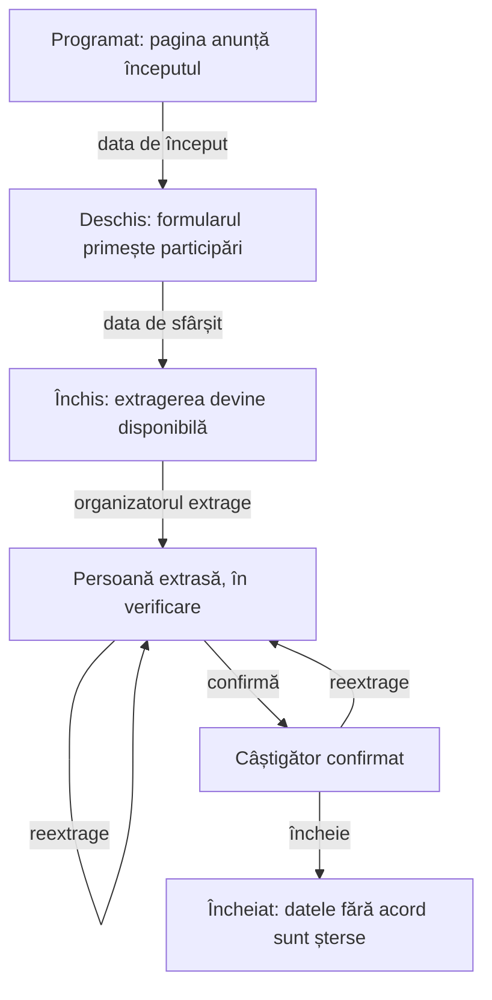
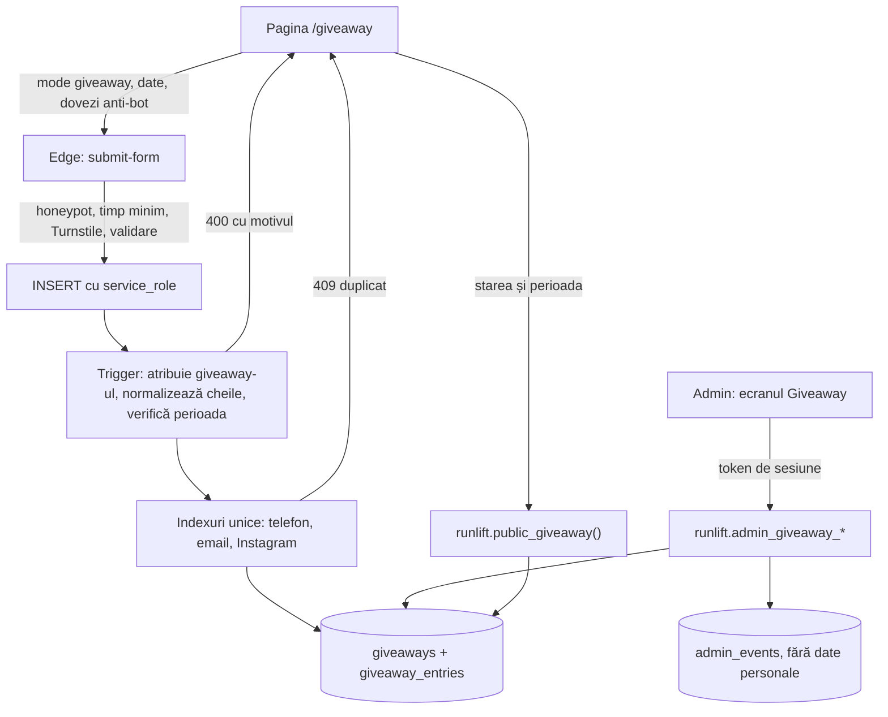

# Giveaway pe Instagram cu formular pe site și extragere în admin - Plan

## Goal Capsule

- **Objective:** Run + Lift poate organiza un giveaway pe Instagram împreună cu un sponsor și rămâne, la final, cu contactele participanților care au acceptat să fie contactați și cu un câștigător ales la întâmplare dintre participări reale, într-un mod pe care îl poate arăta sponsorului și participanților.
- **Means:** formularul scrie prin poarta anti-bot existentă, baza de date impune perioada, dublurile, extragerea și încheierea, iar adminul le comandă prin RPC-uri cu token (KTD1–KTD8).
- **Authority:** Product Contract-ul definește comportamentul, confirmat de organizator pe 14 noiembrie 2026. Planning Contract-ul definește implementarea. Unde codul contrazice planul, codul câștigă și diferența se notează.
- **Execution profile:** React + CSS Modules, o migrare SQL în schema `runlift`, un mod nou în funcția Edge `submit-form`. Lucrul pornește dintr-o ramură nouă din `main`, nu din `feat/programare-stage-1`.
- **Stop conditions:** oprește-te și întreabă dacă apare una dintre situațiile de mai jos.
  - Modul nou din `submit-form` ar schimba comportamentul modurilor existente.
  - PostgREST nu propagă textul excepției din trigger așa cum presupune KTD2.
  - `lint:arch` nu acceptă importul transportului din `features/inscriere` fără o mutare mai mare decât un export.
  - Un pas cere datele reale ale primului giveaway.
- **Tail ownership:** implementare și verificare locală cu `npm run verify`. Aplicarea migrării în producție, deploy-ul funcției Edge, merge-ul și inserarea rândului primului giveaway se fac la cererea operatorului.
- **Open blockers:** niciunul pentru U1–U6. U7 așteaptă materialele din Dependencies / Assumptions.

---

## Product Contract

**Product Contract preservation:** changed: R1, R3, R12, R14, R15 — precizate cu răspunsurile la întrebările amânate pentru planificare (adresa, câmpul de nume, locul în admin, ștergerea, prefixul de telefon). R26 adăugat — reextragerea după confirmare, pe care contractul nu o hotăra. R27 adăugat — răspunsul la întrebarea amânată despre giveaway-urile anterioare în admin. Legătura deciziei „Formular pe site” corectată de la R20 la R21. Niciun requirement scos.

### Summary

O pagină de giveaway pe site, cu link direct din Instagram, unde oamenii se înscriu o singură dată, între o dată de început și una de sfârșit, și pot accepta opțional să fie contactați ulterior.
Un ecran în /admin arată participările, permite ștergerea și exportul, extrage câștigătorul după închidere și încheie giveaway-ul ștergând datele celor care nu au dat acordul.
Fiecare giveaway își ține separat participările și câștigătorul.

### Problem Frame

Run + Lift pregătește un giveaway pe pagina de Instagram, împreună cu o companie care sponsorizează premiul.
Un giveaway obișnuit pe Instagram (follow, like, comentariu) aduce vizibilitate, dar nu lasă nimic în urmă: organizatorul nu află telefonul sau emailul nimănui și nu poate invita participanții la antrenamente sau la ediția următoare.
De aceea participarea trece printr-un formular.

Formularul aduce trei probleme pe care un comentariu nu le are.
Un premiu atrage înscrieri false și repetate.
Datele strânse sunt date personale, iar cine le-a dat doar pentru premiu nu a acceptat să fie contactat mai târziu.
Cu un sponsor implicat, organizatorul trebuie să poată arăta că a ales câștigătorul la întâmplare, dintre participări reale.

Site-ul are deja formulare publice protejate anti-bot și un admin cu liste, ștergere și export, dar nimic pentru giveaway.

### Key Decisions

- **Pagină dedicată cu link direct, fără buton pe homepage.** Cine vine din Instagram ajunge direct la formular. Governs R1. (session-settled: user-approved — chosen over un buton sau banner pe homepage: ar concura cu înscrierea la eveniment)
- **Formular pe site, nu Google Form.** Governs R7, R11, R21. (session-settled: user-approved — chosen over un formular extern: nu poate bloca dublurile, nu poate șterge contactele fără acord și ține contactele în afara adminului)
- **Contactele rămân la Run + Lift, nu ajung la sponsor.** Governs R5, R21. (session-settled: user-directed — chosen over partajarea cu sponsorul și ștergerea tuturor după giveaway: organizatorul vrea să poată invita participanții la evenimente și antrenamente)
- **Acordul de contact e opțional.** Governs R5. (session-settled: user-directed — chosen over acord obligatoriu pentru participare: mai puține contacte, dar fiecare e consimțit separat de participare)
- **O singură participare de persoană, blocată la trimitere.** Governs R11, R12. (session-settled: user-directed — chosen over acceptare cu marcare în admin și participări multiple: organizatorul nu curăță dubluri de mână înainte de extragere)
- **Înscrierile se închid singure la data de sfârșit.** Governs R8, R10. (session-settled: user-directed — chosen over închidere manuală din admin: data e anunțată pe pagină și nu depinde de prezența organizatorului)
- **Extragerea se face în admin.** Governs R17–R20. (session-settled: user-approved — chosen over export CSV și extragere în alt instrument: adminul alege doar dintre participările active, reține cine a câștigat și când și permite reextragerea)
- **Un câștigător confirmat poate fi înlocuit până la încheiere.** Governs R26. (session-settled: user-approved — chosen over blocarea reextragerii după confirmare: câștigătorul poate deveni de negăsit sau poate refuza premiul)
- **Condițiile de pe Instagram se verifică manual, pe persoana extrasă.** Governs R19. (session-settled: user-approved — chosen over verificare la înscriere: formularul nu poate vedea follow, like sau comentariu)
- **Datele celor fără acord se șterg printr-o acțiune de încheiere din admin.** Governs R21–R23. (session-settled: user-directed — chosen over ștergere automată după un număr de zile și păstrarea lor: organizatorul decide momentul, după predarea premiului)
- **Ștergerea unei participări e definitivă, după o confirmare.** Governs R15. (session-settled: user-approved — chosen over ștergere cu anulare, ca la înscrieri: ștergerea e și calea prin care o persoană e scoasă la cerere)
- **Un giveaway acum, cu datele separate pe giveaway.** Un giveaway nou se pregătește printr-o modificare mică de cod și un rând nou în baza de date, nu din admin. Governs R24, R25. (session-settled: user-directed — chosen over un singur giveaway fără nimic pentru al doilea și giveaway-uri create din admin: urmează probabil altele, dar nu destule cât să justifice un editor)
- **Adminul poate deschide orice giveaway, nu doar pe cel curent.** Altfel un giveaway neîncheiat ar deveni de neatins când începe următorul, iar datele lui fără acord ar rămâne neșterse. Governs R27.
- **O participare ștearsă nu mai blochează reînscrierea.** Cine s-a retras se poate răzgândi, iar o înscriere falsă reapărută se șterge din nou. Governs R13.
- **Vârsta minimă stă în regulament, nu într-un câmp.** Formularul nu cere data nașterii. Governs R4.

### Actors

- A1. Participant: urmăritor de pe Instagram care deschide linkul și completează formularul.
- A2. Organizator: administratorul Run + Lift, care urmărește participările, șterge, extrage, confirmă câștigătorul și încheie giveaway-ul.
- A3. Sponsor: compania care oferă premiul. Apare pe pagină și nu folosește site-ul.

### Requirements

**Pagina și formularul**

- R1. Giveaway-ul are o pagină proprie pe site, la adresa `/giveaway`, la care se ajunge din linkul de pe Instagram; homepage-ul nu primește buton sau banner către ea.
- R2. Pagina arată premiul, numele și logoul sponsorului, perioada giveaway-ului, condițiile de participare și regulamentul.
- R3. Formularul cere numele într-un singur câmp, telefonul, emailul și numele de utilizator de Instagram, toate obligatorii.
- R4. Participarea cere bifarea acceptării regulamentului.
- R5. Formularul are o bifă separată, opțională și nebifată implicit, prin care participantul acceptă să fie contactat ulterior de Run + Lift despre evenimente și antrenamente.
- R6. După o trimitere reușită, participantul vede pe pagină confirmarea că e înscris.
- R7. Trimiterile trec, pe server, prin aceleași verificări anti-bot ca înscrierea la eveniment.

**Perioada**

- R8. Giveaway-ul are o dată și oră de început și una de sfârșit, stabilite înainte de lansare.
- R9. Înainte de început, pagina anunță când începe giveaway-ul și nu arată formularul.
- R10. La data de sfârșit înscrierile se închid singure: pagina spune că s-au încheiat, iar o trimitere sosită după acel moment e refuzată.

**O participare de persoană**

- R11. O persoană participă o singură dată la un giveaway: dacă telefonul, emailul sau numele de Instagram există deja într-o participare activă, formularul îi spune că e deja înscrisă și nu salvează nimic.
- R12. Compararea ignoră diferențele de scriere: spații și separatori în telefon, prefixul `0` față de `+373`, majuscule în email, majuscule și „@” în numele de Instagram.
- R13. O participare ștearsă de organizator nu mai blochează o nouă înscriere cu aceleași date.

**Ecranul din admin**

- R14. /admin are, în zona Site, un ecran al giveaway-ului care arată numărul de participări active și lista lor, cu datele din formular, momentul înscrierii și acordul de contact.
- R15. Organizatorul poate șterge definitiv o participare, după o confirmare, în orice stare a giveaway-ului; participarea ștearsă iese din număr și nu poate fi extrasă.
- R16. Organizatorul poate exporta lista ca CSV, cu acordul de contact ca o coloană.

**Extragerea**

- R17. După data de sfârșit, organizatorul extrage din admin, la întâmplare, o persoană dintre participările active; înainte de sfârșit extragerea nu e disponibilă.
- R18. Adminul reține persoana extrasă și momentul extragerii și le arată pe ecranul giveaway-ului.
- R19. Organizatorul confirmă persoana extrasă drept câștigător sau reextrage; persoanele extrase anterior nu mai intră în extragere și rămân marcate în listă.
- R20. Dacă nu mai e nicio participare eligibilă, extragerea spune asta și nu alege pe nimeni.
- R26. Reextragerea rămâne posibilă și după confirmare, până la încheiere.

**Încheierea**

- R21. După confirmarea câștigătorului, organizatorul poate încheia giveaway-ul; încheierea șterge datele de contact ale participanților care nu au dat acordul de contact.
- R22. După încheiere rămân participările cu acord de contact, numărul total de participări și înregistrarea câștigătorului (nume, nume de Instagram, momentul extragerii); reextragerea nu mai e posibilă.
- R23. Încheierea e ireversibilă și cere o confirmare explicită care spune asta.

**Mai multe giveaway-uri**

- R24. Participările, extragerea și câștigătorul aparțin unui giveaway anume: un giveaway nou pornește cu lista goală și nu atinge datele celui dinainte.
- R25. Cine a participat la un giveaway poate participa și la următorul.
- R27. Când există mai multe giveaway-uri, ecranul din admin îl deschide pe cel curent și permite alegerea oricărui altuia.

### Key Flows

Stările unui giveaway.



- F1. Participare
  - **Trigger:** A1 deschide linkul din Instagram cât timp giveaway-ul e deschis.
  - **Actors:** A1
  - **Steps:** Citește premiul, condițiile și regulamentul. Completează cele patru câmpuri. Bifează regulamentul și, dacă vrea, acordul de contact. Trimite.
  - **Outcome:** vede confirmarea, iar participarea apare în admin. Dacă e deja înscris, află asta și nu se salvează nimic.
  - **Covered by:** R1–R7, R11, R12
- F2. Extragere și confirmare
  - **Trigger:** data de sfârșit a trecut.
  - **Actors:** A2
  - **Steps:** A2 șterge participările pe care le consideră nevalide și extrage. Verifică manual pe Instagram condițiile pentru persoana extrasă și o contactează. Confirmă sau reextrage.
  - **Outcome:** un câștigător confirmat, cu momentul extragerii reținut.
  - **Covered by:** R15, R17–R20, R26
- F3. Încheiere
  - **Trigger:** premiul a fost predat.
  - **Actors:** A2
  - **Steps:** A2 alege încheierea și confirmă că e ireversibilă.
  - **Outcome:** rămân contactele cu acord, numărul total și înregistrarea câștigătorului.
  - **Covered by:** R21–R23

### Acceptance Examples

- AE1. **Covers R3–R6, R14.** **Given** giveaway-ul e deschis, **when** Ana completează cele patru câmpuri, bifează regulamentul, lasă acordul de contact nebifat și trimite, **then** vede confirmarea, iar adminul arată o participare în plus, fără acord de contact.
- AE2. **Covers R4.** **Given** giveaway-ul e deschis, **when** cineva trimite formularul fără bifa de regulament, **then** formularul cere bifa și nu salvează nimic.
- AE3. **Covers R11, R12.** **Given** Ana e înscrisă cu `@Ana.Run` și `+373 69 123 456`, **when** cineva trimite formularul cu `ana.run`, alt email și alt telefon, **then** află că e deja înscris, iar numărul de participări nu se schimbă.
- AE4. **Covers R13, R15.** **Given** organizatorul a șters participarea Anei, **when** Ana trimite din nou formularul cu aceleași date, **then** participarea e acceptată.
- AE5. **Covers R9, R10.** **Given** un participant a deschis pagina înainte de data de sfârșit și a lăsat-o deschisă, **when** trimite formularul după data de sfârșit, **then** trimiterea e refuzată și află că înscrierile s-au încheiat.
- AE6. **Covers R17.** **Given** giveaway-ul e încă deschis, **when** organizatorul deschide ecranul din admin, **then** vede participările, dar nu poate extrage.
- AE7. **Covers R18, R19.** **Given** extragerea l-a ales pe Ion, iar Ion nu urmărește pagina sponsorului, **when** organizatorul reextrage, **then** e aleasă altă persoană, Ion rămâne marcat ca extras anterior și nu mai poate fi ales.
- AE8. **Covers R21, R22.** **Given** 120 de participări, dintre care 45 cu acord de contact, și un câștigător confirmat, **when** organizatorul încheie giveaway-ul, **then** lista arată cele 45 de contacte și înregistrarea câștigătorului, numărul total rămâne 120, iar reextragerea nu mai e disponibilă.
- AE9. **Covers R15, R22.** **Given** giveaway-ul e încheiat, **when** un participant cu acord cere să fie scos și organizatorul îi șterge participarea, **then** contactul dispare din listă și din export.
- AE10. **Covers R24, R25.** **Given** primul giveaway e încheiat și începe al doilea, **when** Ana, participantă la primul, se înscrie, **then** e acceptată, iar lista celui de-al doilea o conține doar pe ea.
- AE11. **Covers R26.** **Given** Maria e câștigătoare confirmată și giveaway-ul nu e încheiat, **when** organizatorul reextrage, **then** e aleasă altă persoană, Maria rămâne marcată ca extrasă anterior, iar giveaway-ul nu mai are câștigător confirmat.
- AE12. **Covers R24, R27.** **Given** primul giveaway are câștigător confirmat, dar nu e încheiat, iar al doilea a început, **when** organizatorul alege primul giveaway în admin și îl încheie, **then** datele fără acord ale primului sunt șterse, iar participările celui de-al doilea rămân neatinse.

### Success Criteria

- De la lansare până la încheiere, organizatorul duce giveaway-ul la capăt doar din pagina publică și din /admin, fără modificări de cod și fără acces direct la baza de date.

### Scope Boundaries

- Participantul nu primește email de confirmare.
- Site-ul nu verifică follow, like sau comentariu pe Instagram.
- Site-ul nu anunță câștigătorul și nu îl contactează; organizatorul face asta pe Instagram sau la telefon.
- Sponsorul nu primește export și nu are acces la admin.
- Contactele cu acord nu primesc emailuri din instrumentele site-ului; exportul din R16 e singura cale de a le folosi în afara adminului.
- Giveaway-urile nu se creează și nu se editează din admin (titlu, premiu, sponsor, date).
- O extragere alege o singură persoană; fără mai mulți câștigători și fără șanse suplimentare.
- Organizatorul nu poate edita o participare, doar o poate șterge.
- Pagina publică nu arată numărul de participanți.

Luate în calcul și neconstruite:

- Limitare de trimiteri pe adresă IP. Turnstile și blocarea dublurilor acoperă cazul; se reia dacă lista se umple cu înscrieri false care trec de ele.
- Verificarea telefonului sau a emailului prin cod. Organizatorul contactează oricum persoana extrasă și reextrage dacă nu răspunde.
- Constrângere care interzice perioade suprapuse între giveaway-uri. Rândurile sunt inserate de operator, câte unul, iar KTD2 alege determinist; se reia dacă giveaway-urile ajung să fie create din admin.
- Trecerea paginii între stări la secundă, fără reîncărcare, pe o pagină lăsată deschisă. Serverul refuză trimiterea întârziată per R10, iar pagina arată atunci închiderea.

#### Deferred to Follow-Up Work

- Card de share propriu pentru `/giveaway`. Până atunci, un link trimis pe WhatsApp sau Telegram arată cardul homepage-ului.

### Dependencies / Assumptions

- Organizatorul furnizează înainte de lansare textul regulamentului, premiul, numele și logoul sponsorului, datele de început și de sfârșit și condițiile de pe Instagram.
- Regulamentul spune cine poate participa, inclusiv vârsta minimă, și cum sunt folosite datele.
- Textul regulamentului și al celor două bife nu a fost verificat juridic; verificarea rămâne în grija organizatorului.
- Pagina e în română, ca restul site-ului.
- Câștigătorul e contactat înainte de încheiere; după încheiere, telefonul și emailul lui rămân doar dacă a dat acordul de contact.

### Sources / Research

- `ANTI-BOT.md`, `supabase/functions/submit-form/index.ts`: poarta unică de scriere a formularelor publice (honeypot, timp minim pe formular, Turnstile verificat pe server). Rolul `anon` nu are INSERT, deci un formular nou trece tot pe aici.
- `src/shared/lib/validation.ts`: `EMAIL_RE`, `PHONE_RE`, `normalizePhone`, refolosibile pentru R3 și R12.
- `src/features/inscriere/components/RegistrationForm.tsx`: `BifaAcord`, modelul de bifă de acord dintr-un formular public.
- `src/shared/lib/csv.ts` (`toCsv`) și `exportCsv` din `src/features/admin/pages/AdminDashboard.tsx`: modelul de export CSV din admin.
- `supabase/sql/supabase-migration-soft-delete-registrations.sql`: ștergere logică cu anulare, tiparul înscrierilor, de la care KTD5 se abate deliberat.
- `src/features/admin/navigatie/adminNavigatie.ts`: registrul de zone, file și ecrane ale adminului.
- `src/app/routes.ts`, `vercel.json`: o pagină nouă cere o intrare în registrul de rute și un rewrite cu aceeași cale.
- `MIGRATIONS.md`: schema `runlift` e a acestui repo, iar migrările se aplică manual.
- Codul nu are azi nicio funcționalitate de giveaway. „Număr de concurs” din admin e numărul de start al unui participant la eveniment.

---

## Planning Contract

### Key Technical Decisions

- KTD1. **Perioada și identitatea giveaway-ului stau în baza de date, textele în cod.** Un rând din `runlift.giveaways` poartă `slug`, `titlu`, `starts_at`, `ends_at` și câmpurile de stare; premiul, sponsorul, condițiile și regulamentul stau în `src/features/giveaway/content.ts`, sub același `slug`. Serverul trebuie să refuze singur trimiterile de după sfârșit, deci perioada nu poate trăi doar în client, iar o a doua copie a datelor în cod s-ar desincroniza. Instantiates R8–R10, R24. (session-settled: user-approved — chosen over perioada scrisă doar în cod: serverul n-ar putea refuza trimiterile întârziate)
- KTD2. **Serverul decide giveaway-ul curent și perioada; clientul nu le trimite niciodată.** Curent e giveaway-ul deschis acum, altfel următorul programat, altfel cel mai recent terminat. Un trigger `BEFORE INSERT` pe `runlift.giveaway_entries` atribuie giveaway-ul, normalizează cheile din KTD3 și refuză cu `giveaway_neinceput`, `giveaway_inchis` sau `fara_giveaway`. E aceeași disciplină ca la `editie`, iar textul excepției ajunge la client ca la `registration_closed`. Instantiates R10, R24.
- KTD3. **Dublurile sunt oprite de trei indexuri unice pe giveaway.** Cheile sunt telefonul canonic, emailul cu litere mici și numele de Instagram fără „@”, cu litere mici. Cheia de telefon tratează `0XXXXXXXX`, `373XXXXXXXX` și `+373XXXXXXXX` ca același număr; telefonul afișat rămâne cel trimis. O încălcare ajunge la client ca HTTP 409, pe care `isDuplicateError` o recunoaște deja. Instantiates R11, R12, R25.
- KTD4. **Scrierea trece prin `submit-form`, cu modul nou `giveaway`.** Funcția validează numele, emailul, telefonul, numele de Instagram și bifa de regulament, fiindcă `service_role` ocolește RLS. Numele de Instagram acceptă forma cu „@”, forma simplă sau linkul de profil și trebuie să ajungă la 1–30 de caractere din litere, cifre, punct și liniuță jos. Modul nu trimite niciun email. Instantiates R3–R5, R7.
- KTD5. **Ștergerea e un `DELETE` real, fără `deleted_at`.** Indexurile din KTD3 nu mai au nevoie de varianta parțială, iar R13 rezultă direct. Instantiates R13, R15. (session-settled: user-approved — chosen over ștergere logică cu anulare, ca la înscrieri: ștergerea e și calea prin care o persoană e scoasă la cerere)
- KTD6. **Extragerea se face în baza de date, într-o singură tranzacție.** Funcția blochează rândul giveaway-ului, marchează ca înlocuită persoana extrasă curent și alege una dintre participările niciodată extrase, ordonate după `gen_random_uuid()`. Două apăsări simultane nu pot produce doi extrași, iar pagina de admin nu poate influența rezultatul. Instantiates R17–R20, R26.
- KTD7. **Starea extragerii stă pe participări, câștigătorul confirmat pe giveaway.** Participarea poartă `extrasa_la` și `inlocuita_la`. La confirmare, giveaway-ul primește o copie cu numele, numele de Instagram, momentul extragerii și `confirmat_la`; reextragerea de după confirmare o golește. Copia face ca înregistrarea câștigătorului să supraviețuiască ștergerii rândului. Instantiates R18, R19, R22, R26.
- KTD8. **Încheierea șterge rândurile fără acord de contact și notează totalul.** Giveaway-ul primește `incheiat_la` și `total_participari`, numărate înainte de ștergere. După încheiere, extragerea, confirmarea și o a doua încheiere sunt refuzate cu `giveaway_incheiat`. Instantiates R21–R23.
- KTD9. **Jurnalul `admin_events` reține acțiunea, giveaway-ul și id-ul participării, niciodată numele sau contactele.** Altfel o ștergere ar lăsa datele în jurnal. Instantiates R15, R21.
- KTD10. **Tabelele noi nu dau niciun drept rolurilor `anon` și `authenticated`.** RLS e pornit fără politici; citirea și scrierea trec doar prin `public_giveaway()`, prin funcțiile `admin_giveaway_*` și prin cheia de service a funcției Edge. Proiectul Supabase e împărțit cu altă aplicație, deci `authenticated` nu înseamnă „organizator”.
- KTD11. **Citirea publică e `runlift.public_giveaway()`.** Întoarce `slug`, perioada și starea calculată pe server (`programat`, `deschis`, `inchis`) sau `null`, fără numere și fără date personale. Când `slug`-ul primit nu are conținut în cod, pagina arată „niciun giveaway activ”, deci rândul și conținutul pot ajunge în producție în orice ordine. Instantiates R2, R9, R10.
- KTD12. **Pagina e o rută independentă de ediție, pe shell-ul `index.html`.** Stă lângă `/despre-noi` și `/antrenament` în `independentPages` și își citește singură RPC-ul. Instantiates R1.
- KTD13. **Transportul și dovezile anti-bot rămân în `features/inscriere` și se exportă prin `index.ts`.** `lint:arch` permite importul între funcționalități doar prin index, iar o copie a capcanei e regresia pe care o păzește `tests/unit/antiBotSurfaces.test.tsx`. Instantiates R7.
- KTD14. **Ecranul din admin e o filă nouă „Giveaway” în zona Site, cu cheia `giveaway`.** Își încarcă singur datele prin `useAdminResource`, ca ecranele grupului din parc, iar exportul CSV se construiește în browser din lista încărcată. Instantiates R14, R16.
- KTD15. **Funcțiile adminului primesc giveaway-ul ca parametru.** `admin_giveaway_date` întoarce și lista giveaway-urilor, iar ștergerea, extragerea, confirmarea și încheierea se aplică giveaway-ului afișat, nu celui curent în clipa apăsării. Instantiates R24, R27.

### High-Level Technical Design

Cine scrie și cine citește.



Starea se deduce din câmpurile stocate, într-un singur loc din SQL. Pagina publică vede doar primele trei stări; tot ce urmează după sfârșit îi apare ca `inchis`.

| Stare | Cum se deduce | Ce permite adminul |
|---|---|---|
| `programat` | `now() < starts_at` | lista, goală |
| `deschis` | `starts_at <= now() < ends_at` | ștergere, export |
| `inchis` | `now() >= ends_at`, nicio persoană extrasă în curs | ștergere, export, extragere |
| `extras` | o participare cu `extrasa_la` și fără `inlocuita_la`, fără `confirmat_la` | confirmare, reextragere, ștergere, export |
| `confirmat` | `confirmat_la` setat, fără `incheiat_la` | reextragere, încheiere, ștergere, export |
| `incheiat` | `incheiat_la` setat | ștergere, export |

### Output Structure

```text
src/features/giveaway/
├── index.ts            # ruta
├── route.ts
├── content.ts          # premiu, sponsor, condiții, regulament, pe slug
├── data/api.ts         # public_giveaway + trimiterea participării
├── hooks/              # starea publică și formularul
├── lib/                # validarea și normalizarea câmpurilor
└── pages/              # GiveawayPage + stiluri + test
src/features/admin/zones/site/
├── giveawayApi.ts      # RPC-urile admin_giveaway_*
└── EcranGiveaway.tsx   # lista, exportul, extragerea, încheierea
supabase/sql/supabase-migration-giveaway.sql
tests/unit/sql/giveaway.test.ts
tests/e2e/giveaway.spec.ts
```

### Sequencing

U1 și U2 scriu aceeași migrare și vin primele. U3 depinde de tabelul din U1. U4 depinde de U1 și U3, U5 de U2, U6 de U5. U7 vine ultimul și așteaptă materialele organizatorului.

---

## Implementation Units

### U1. Tabelele, garda de înscriere și citirea publică

**Goal:** baza de date ține giveaway-urile și participările, refuză singură înscrierile din afara perioadei și dublurile și spune site-ului starea curentă.

**Requirements:** R8–R13, R24, R25; KTD1, KTD2, KTD3, KTD10, KTD11.

**Dependencies:** niciuna.

**Files:**
- `supabase/sql/supabase-migration-giveaway.sql` (nou)
- `tests/unit/sql/giveaway.test.ts` (nou)
- `tests/unit/sql/db.ts` (`MIGRARI_NEAPLICATE`, `TABELE`)
- `tests/unit/sql/drepturi.test.ts` (încadrarea funcției publice noi)
- `MIGRATIONS.md` (secțiune „Migrare pregătită — Giveaway”, neaplicată live)

**Approach:**
1. Creează `runlift.giveaways` și `runlift.giveaway_entries`, cu `ends_at > starts_at`, `slug` unic și ștergere în cascadă de la giveaway la participări.
2. Scrie funcția internă care alege giveaway-ul curent și funcția care deduce starea, folosite de trigger, de citirea publică și de funcțiile din U2.
3. Adaugă triggerul și indexurile unice. Funcția triggerului rulează `security definer`, ca inserarea să nu ceară drept de citire pe `giveaways`.
4. Acordă explicit rolului `service_role` dreptul de inserare pe `giveaway_entries`; migrarea nu se bazează pe drepturile implicite ale schemei.
5. Pune plafoane de lungime pe câmpurile text ale participării.
6. Adaugă `public_giveaway()` cu `security definer` și `search_path` gol, cu drepturile celorlalte funcții `public_*`.
7. Migrarea se poate rula de mai multe ori, ca restul fișierelor din `supabase/sql/`.

**Patterns to follow:** `supabase/sql/supabase-migration-homepage-ordine-locatie.sql` pentru tabel cu RLS fără politici, funcție publică și granturi; triggerul `forteaza_editia_curenta` și `registrations_guard_trg` din `supabase/schema/runlift.sql` pentru atribuirea pe server și refuzul cu text; `tests/unit/sql/homepage.test.ts` pentru forma testelor.

**Test scenarios:**
- Fără niciun giveaway, `public_giveaway()` întoarce `null`.
- Un giveaway care începe mâine apare ca `programat`, unul început ieri și deschis până mâine ca `deschis`, unul terminat ieri ca `inchis`, fiecare cu `slug` și perioada lui.
- Cu un giveaway terminat și altul programat pentru săptămâna viitoare, curent e cel programat, ca pagina să-l anunțe; un giveaway deschis are întâietate față de unul programat.
- O inserare ca rol `service_role` în perioada deschisă reușește și primește giveaway-ul curent; un `giveaway_id` trimis explicit spre alt giveaway e suprascris.
- Un nume de cinci sute de caractere e refuzat de constrângere.
- O inserare înainte de început e refuzată cu `giveaway_neinceput`, una după sfârșit cu `giveaway_inchis`, una fără niciun giveaway cu `fara_giveaway`.
- Covers AE3. După o participare cu `@Ana.Run`, o a doua cu `ana.run` și alte contacte încalcă unicitatea.
- După o participare cu `069123456`, o a doua cu `+37369123456` și alte contacte încalcă unicitatea; la fel `Ana@Exemplu.ro` față de `ana@exemplu.ro`.
- Covers AE10. Aceleași date sunt acceptate într-un al doilea giveaway, iar primul rămâne neatins.
- `anon` și `authenticated` nu pot citi și nu pot scrie niciunul dintre tabele; `anon` poate chema `public_giveaway()`.
- Răspunsul `public_giveaway()` nu conține numărul de participări și nicio dată personală.
- Un giveaway cu `ends_at` înaintea lui `starts_at` e refuzat de constrângere.

**Verification:** testele SQL trec pe instantaneul schemei plus migrarea; `drepturi.test.ts` rămâne verde cu funcția nouă încadrată explicit.

### U2. Funcțiile adminului: citire, ștergere, extragere, confirmare, încheiere

**Goal:** organizatorul poate vedea participările și poate duce giveaway-ul până la capăt doar prin funcții care îi verifică tokenul.

**Requirements:** R14, R15, R17–R23, R26, R27; KTD5–KTD9, KTD15.

**Dependencies:** U1.

**Files:**
- `supabase/sql/supabase-migration-giveaway.sql`
- `tests/unit/sql/giveaway.test.ts`
- `tests/unit/sql/drepturi.test.ts` (încadrarea funcțiilor `admin_giveaway_*`)

**Approach:**
1. `admin_giveaway_date` întoarce lista giveaway-urilor și, pentru cel cerut sau, în lipsa parametrului, pentru cel curent, starea din tabelul de stări, persoana extrasă, copia câștigătorului, totalul și participările. Fără niciun giveaway întoarce un giveaway `null`.
2. `admin_giveaway_sterge` șterge o participare în orice stare. Ștergerea persoanei extrase și neconfirmate readuce starea la `inchis`.
3. `admin_giveaway_extrage` acoperă prima extragere și reextragerea, per KTD6 și KTD7.
4. `admin_giveaway_confirma` și `admin_giveaway_incheie` urmează KTD7 și KTD8.
5. Fiecare funcție începe cu `admin_check_token`, refuză cu un motiv scurt când starea nu permite acțiunea și lasă un rând în `admin_events` per KTD9.

**Patterns to follow:** `admin_set_homepage_order` pentru verificarea tokenului, jurnal și granturi; funcțiile `admin_sala_*` din `supabase/schema/runlift.sql` pentru citirea în bloc ca `jsonb` și pentru refuzurile cu motiv.

**Test scenarios:**
- Fiecare funcție refuză un token inventat cu `invalid_token` și nu schimbă nimic.
- `admin_giveaway_date` întoarce starea, lista cu acordul de contact și momentul înscrierii și numărul de participări; fără niciun giveaway întoarce giveaway `null`.
- Cu două giveaway-uri, apelul fără parametru îl întoarce pe cel curent și lista ambelor; apelul cu id-ul primului întoarce participările primului.
- Covers AE12. Încheierea primului giveaway după ce al doilea a început șterge doar rândurile fără acord ale primului.
- Covers AE4. După ștergere, participarea lipsește din listă, numărul scade, iar o nouă inserare cu aceleași date e acceptată.
- Ștergerea unui id inexistent e refuzată și nu lasă rând în jurnal.
- Covers AE6. Extragerea pe un giveaway deschis e refuzată; lista rămâne citibilă.
- După sfârșit, extragerea marchează exact o participare, starea devine `extras`, iar momentul extragerii e reținut.
- Covers AE7. La reextragere, persoana dinainte primește `inlocuita_la` și nu mai e aleasă; cu trei participări, a patra extragere e refuzată cu `fara_participari`.
- Extragerea pe un giveaway închis fără participări e refuzată cu `fara_participari`.
- Pe două sute de extrageri de probă dintre aceleași două participări, fiecare dintre ele e aleasă cel puțin o dată.
- Confirmarea fără persoană extrasă e refuzată; după confirmare, starea e `confirmat`, iar giveaway-ul poartă copia câștigătorului.
- Covers AE11. Reextragerea după confirmare readuce starea la `extras`, golește copia și marchează fostul câștigător ca înlocuit.
- Încheierea fără câștigător confirmat e refuzată cu `fara_castigator`.
- Covers AE8. Cu cinci participări, două cu acord, și un câștigător fără acord, încheierea lasă cele două rânduri, totalul cinci și copia câștigătorului.
- După încheiere, extragerea, confirmarea și o a doua încheiere sunt refuzate cu `giveaway_incheiat`.
- Covers AE9. După încheiere, ștergerea unei participări cu acord o scoate din listă.
- Ștergerea persoanei extrase și neconfirmate readuce starea la `inchis`, iar următoarea extragere alege din restul.
- Fiecare scriere reușită lasă un rând în `admin_events`, iar detaliul lui nu conține nume, telefon, email sau nume de Instagram.

**Verification:** testele SQL trec; inventarul din `drepturi.test.ts` arată că nicio funcție `admin_giveaway_*` nu răspunde fără token valid.

### U3. Modul `giveaway` în `submit-form`

**Goal:** o participare validă ajunge în tabel doar după verificările anti-bot, iar una invalidă e oprită înainte de scriere.

**Requirements:** R3–R5, R7, R10, R11; KTD4.

**Dependencies:** U1.

**Files:**
- `supabase/functions/submit-form/index.ts`
- `tests/unit/edge/submitForm.test.ts`
- `ANTI-BOT.md` (lista modurilor)

**Approach:**
1. Adaugă modul în `Mode` și în `TABLE`, cu o funcție de validare proprie, lângă `validateEventRow` și `validateLaunchRow`.
2. Rândul scris conține numele, telefonul normalizat, emailul, numele de Instagram normalizat, bifa de regulament și acordul de contact; nimic despre giveaway sau perioadă, per KTD2.
3. Răspunsurile de eroare de la PostgREST se propagă neschimbate, ca la celelalte moduri.
4. Modurile existente și ordinea filtrelor nu se schimbă.

**Patterns to follow:** `validateLaunchRow` și ramura `launch` din handler; cazurile `LANSARE` din `tests/unit/edge/submitForm.test.ts`.

**Test scenarios:**
- O participare validă produce un singur INSERT în `giveaway_entries`, cu telefonul `069 509 949` scris `069509949`, emailul fără spații și `@Ana.Run` scris `ana.run`.
- Linkul `https://www.instagram.com/ana.run/` ajunge în rând ca `ana.run`.
- `acord_contact` lipsă sau cu altă valoare decât `true` se scrie `false`.
- Un nume de două caractere, un email fără domeniu, un telefon de cinci cifre, un nume de Instagram cu spații sau de 31 de caractere și bifa de regulament nebifată întorc fiecare `invalid:<câmp>`, fără niciun apel spre PostgREST.
- Un `giveaway_id` sau un `slug` trimis în date nu apare în rândul scris.
- Un 409 de la PostgREST ajunge la client ca 409; un 400 cu `giveaway_inchis` ajunge cu același text.
- Honeypotul completat, trimiterea sub trei secunde și tokenul Turnstile respins opresc și modul nou.
- Modul nu cheamă `send-email`.
- Cazurile existente pentru `registration`, `waitlist` și `launch` trec neschimbate.

**Verification:** testele funcției Edge trec, inclusiv cele vechi, fără nicio modificare a lor.

### U4. Pagina publică `/giveaway`

**Goal:** cine deschide linkul din Instagram vede premiul și regulile, se poate înscrie cât timp giveaway-ul e deschis și află clar în ce stare e giveaway-ul în rest.

**Requirements:** R1–R7, R9–R11; F1; KTD11, KTD12, KTD13.

**Dependencies:** U1, U3.

**Files:**
- `src/features/giveaway/index.ts`, `route.ts`, `content.ts` (noi)
- `src/features/giveaway/data/api.ts`, `hooks/`, `lib/` cu testele lor (noi)
- `src/features/giveaway/pages/GiveawayPage.tsx`, `GiveawayPage.module.css`, `GiveawayPage.test.tsx` (noi)
- `src/features/inscriere/index.ts`, `src/features/inscriere/data/api.ts` (exportul transportului și al helperelor anti-bot)
- `src/app/routes.ts`, `vercel.json`
- `tests/support/handlers.ts`, `tests/support/builders/` (răspuns implicit pentru `public_giveaway`)
- `tests/unit/antiBotSurfaces.test.tsx`, `tests/unit/backend-contract.test.ts`
- `tests/e2e/giveaway.spec.ts` (nou), `tests/e2e/rute.spec.ts`
- `docs/ARCHITECTURE.md` (harta funcționalităților)

**Approach:**
1. Pagina citește `public_giveaway()` și caută conținutul după `slug` în `content.ts`, care pornește fără nicio intrare.
2. Stările paginii sunt: se încarcă, niciun giveaway activ, programat, deschis, închis, eroare de citire cu reîncercare, înscris, deja înscris.
3. Formularul validează în client aceleași reguli ca funcția Edge și trimite `mode: 'giveaway'` prin transportul din `features/inscriere`.
4. Un 409 duce la „deja înscris”; un refuz cu `giveaway_inchis` înlocuiește formularul cu mesajul de închidere; o respingere anti-bot folosește mesajele existente.
5. Logoul sponsorului se servește din `public/`, fiindcă politica `img-src` din `vercel.json` permite doar originea site-ului.
6. Testele de componentă înlocuiesc `content.ts` cu un conținut de probă; producția nu primește niciun giveaway de probă.

**Patterns to follow:** `src/features/despre-noi/` pentru o pagină independentă cu rută lazy; `useLaunchForm` și `lib/launchForm.ts` pentru mașina de stări a formularului; `usePublicQuery` și `src/features/trial/` pentru citirea publică; `BifaAcord` pentru bife; `src/shared/lib/formatare.ts` pentru date.

**Test scenarios:**
- Starea `programat` arată data de început și niciun formular.
- Starea `deschis` arată premiul, sponsorul, perioada, condițiile, regulamentul și formularul cu patru câmpuri și două bife, cea de contact nebifată.
- Covers AE1. O trimitere validă cu acordul de contact nebifat arată confirmarea, iar cererea conține `mode: 'giveaway'` și `acord_contact: false`.
- Covers AE2. Fără bifa de regulament, formularul marchează bifa și nu trimite nicio cerere.
- Un telefon de cinci cifre, un email fără domeniu și un nume de Instagram cu spații marchează fiecare câmpul lui și nu trimit nimic.
- Un link de profil lipit în câmpul de Instagram e acceptat și trimis ca nume simplu.
- Covers AE3. Un răspuns 409 arată mesajul „deja înscris” în locul confirmării obișnuite.
- Covers AE5. Un refuz cu `giveaway_inchis` înlocuiește formularul cu mesajul că înscrierile s-au încheiat.
- Starea `inchis` arată mesajul de închidere și niciun formular.
- Un răspuns `null` și un `slug` fără conținut în cod arată amândouă „niciun giveaway activ”.
- O citire eșuată arată un mesaj și un buton care reîncearcă citirea.
- O respingere anti-bot arată mesajul anti-bot existent și lasă formularul completat.
- Formularul are capcana anti-bot în interiorul lui `<form>`, verificată în `antiBotSurfaces.test.tsx`.
- `public_giveaway` și trimiterea participării pleacă spre proiectul configurat, cu schema `runlift`.
- Pe aplicația construită, accesul direct la `/giveaway` răspunde și arată „niciun giveaway activ”.

**Verification:** `/giveaway` se deschide direct și la reîncărcare; `tests/unit/rute.test.ts` găsește rewrite-ul; `lint:arch` și `deadcode` trec fără excepții noi.

### U5. Ecranul din admin: număr, listă, ștergere, export

**Goal:** organizatorul vede câți s-au înscris și cine, poate scoate o participare și poate descărca lista.

**Requirements:** R14–R16, R27; KTD14, KTD15.

**Dependencies:** U2.

**Files:**
- `src/features/admin/data/stareCurenta.ts` (`EcranAdmin`)
- `src/features/admin/navigatie/adminNavigatie.ts` și testul lui
- `src/features/admin/pages/AdminDashboard.tsx` (`contorEcran`, montarea ecranului)
- `src/features/admin/zones/site/giveawayApi.ts` (nou)
- `src/features/admin/zones/site/EcranGiveaway.tsx`, `EcranGiveaway.module.css`, `EcranGiveaway.test.tsx` (noi)
- `tests/support/handlers.ts`, `tests/support/builders/`

**Approach:**
1. Adaugă cheia `giveaway` în `EcranAdmin`, fila în zona Site și intrarea `null` în `contorEcran`.
2. Ecranul arată titlul și perioada giveaway-ului, starea, numărul de participări și lista. După încheiere arată și totalul de la încheiere.
3. Ștergerea deschide un dialog de confirmare care numește persoana și spune că ștergerea e definitivă.
4. Exportul scrie coloanele din listă plus acordul de contact, cu antet și marcajul BOM, ca exportul participanților.
5. Fără niciun giveaway, ecranul spune asta și nu arată lista.
6. Când lista are mai multe giveaway-uri, un selector schimbă giveaway-ul afișat; cu unul singur, selectorul lipsește.

**Patterns to follow:** `EcranProbe` cu `useTrials.ts` din `src/features/admin/zones/antrenamente/` pentru un ecran care își încarcă singur datele prin `useAdminResource`; `DialogScoatere.tsx` din același folder pentru confirmarea unei acțiuni definitive; `exportCsv` din `AdminDashboard.tsx`.

**Test scenarios:**
- Fila „Giveaway” apare în zona Site, iar `#giveaway` deschide ecranul.
- Cu trei participări, ecranul arată numărul trei și trei rânduri, fiecare cu numele, telefonul, emailul, numele de Instagram, momentul înscrierii și acordul de contact.
- Fără niciun giveaway, ecranul arată mesajul de stare goală.
- Cu două giveaway-uri, selectorul apare, iar alegerea celui vechi îi arată participările; cu unul singur, selectorul lipsește.
- Apăsarea pe ștergere deschide dialogul; anularea nu cheamă nicio funcție.
- Confirmarea cheamă `admin_giveaway_sterge` cu id-ul rândului, apoi lista se reîncarcă fără el.
- Un refuz de la server arată un mesaj și lasă lista neschimbată.
- Exportul a două participări, una cu acord, produce un antet și două rânduri, cu acordul scris diferit pe fiecare.
- O citire eșuată la prima încărcare arată starea de eroare; una eșuată la reîmprospătare păstrează lista de pe ecran.

**Verification:** ecranul se deschide din navigație și din adresă; testele adminului existente trec cu noua cheie de ecran.

### U6. Extragerea, confirmarea și încheierea din admin

**Goal:** organizatorul extrage, confirmă sau reextrage și încheie giveaway-ul din același ecran, cu fiecare pas disponibil doar când starea îl permite.

**Requirements:** R17–R23, R26; F2, F3.

**Dependencies:** U5.

**Files:**
- `src/features/admin/zones/site/EcranGiveaway.tsx`, `EcranGiveaway.module.css`, `EcranGiveaway.test.tsx`
- `src/features/admin/zones/site/giveawayApi.ts`
- `tests/e2e/giveaway.spec.ts`

**Approach:**
1. Un panou deasupra listei arată starea și doar acțiunile din tabelul de stări.
2. Persoana extrasă apare cu numele, contactele și momentul extragerii; persoanele înlocuite rămân marcate în listă.
3. Reextragerea unui câștigător deja confirmat cere o confirmare, fiindcă anulează confirmarea.
4. Încheierea deschide un dialog care spune câte participări fără acord vor fi șterse și că pasul e ireversibil.
5. Motivele de refuz ale serverului se traduc în mesaje scurte, într-un singur loc.

**Patterns to follow:** `mesajRefuzClip` din `src/features/admin/zones/site/api.ts` pentru traducerea refuzurilor; `DialogScoatere.tsx` pentru dialogurile de confirmare.

**Test scenarios:**
- Covers AE6. Pe un giveaway deschis, panoul spune când se închide și nu oferă extragerea.
- Pe un giveaway închis, apăsarea pe extragere cheamă `admin_giveaway_extrage` și arată persoana extrasă cu momentul extragerii.
- Covers AE7. După reextragere, panoul arată noua persoană, iar cea dinainte e marcată în listă ca extrasă anterior.
- Un refuz cu `fara_participari` arată mesajul că nu mai e nimeni de extras.
- Confirmarea cheamă `admin_giveaway_confirma`, iar panoul arată câștigătorul confirmat și oferă încheierea.
- Covers AE11. Reextragerea unui câștigător confirmat cere confirmare; după ea, panoul arată o persoană extrasă neconfirmată.
- Încheierea deschide dialogul cu numărul de participări fără acord și avertismentul de ireversibilitate; anularea nu cheamă nimic.
- Covers AE8. După încheiere, ecranul arată totalul de la încheiere, doar participările cu acord și înregistrarea câștigătorului, fără nicio acțiune de extragere.
- Un refuz cu `giveaway_incheiat` reîncarcă starea și arată un mesaj.
- Pe aplicația construită, cu răspunsuri simulate, organizatorul parcurge extragerea, confirmarea și încheierea.

**Verification:** fiecare stare din tabelul de stări arată exact acțiunile din coloana ei; parcursul e2e trece.

### U7. Primul giveaway: conținut, logo și rândul din baza de date

**Goal:** giveaway-ul cu sponsorul devine vizibil la `/giveaway`, cu textele reale, și se deschide singur la data stabilită.

**Requirements:** R2, R8; Success Criteria.

**Dependencies:** U1–U6 și materialele din Dependencies / Assumptions.

**Files:**
- `src/features/giveaway/content.ts`
- `public/giveaway/` (logoul sponsorului)
- `tests/e2e/giveaway.spec.ts` (parcursul de înscriere cu conținutul real)
- `GHID-GIVEAWAY.md` (nou)

**Approach:**
1. Adaugă intrarea de conținut sub `slug`-ul ales și logoul.
2. Scrie în `GHID-GIVEAWAY.md` pașii pentru un giveaway nou: intrarea de conținut, inserarea rândului cu `slug`, titlu și perioadă, verificarea pe pagină și în admin.
3. Rândul se inserează după ce conținutul e live; ordinea inversă e sigură per KTD11, dar lasă pagina pe „niciun giveaway activ” până la deploy.

**Patterns to follow:** `GHID-EDITIE-NOUA.md` pentru forma ghidului.

**Test scenarios:**
- Covers F1. Pe aplicația construită, cu `public_giveaway` simulat pe `slug`-ul real și starea `deschis`, un participant completează formularul și vede confirmarea.
- Cu starea `programat` pe același `slug`, pagina arată premiul real și data de început.
- Fiecare intrare din `content.ts` are premiu, sponsor, logo existent în `public/`, condiții și regulament.

**Verification:** pe producție, `/giveaway` arată conținutul real în starea așteptată, iar ecranul din admin arată giveaway-ul cu zero participări.

---

## System-Wide Impact

- **Formularele existente:** `submit-form` e poarta înscrierii la eveniment. Modul nou se adaugă lângă cele trei existente, fără să le atingă validarea sau ordinea filtrelor.
- **Date personale:** tabelul nou ține telefoane și emailuri într-un proiect Supabase împărțit cu altă aplicație; KTD10 și testele de drepturi din U1 sunt apărarea.
- **Admin:** `EcranAdmin` e o uniune folosită în înregistrări exhaustive, deci cheia nouă cere intrări în `contorEcran` și în registru, altfel `typecheck` pică.
- **Politica de conținut:** niciun host nou; logoul e servit de pe site.

## Risks & Dependencies

| Risc | Atenuare |
|---|---|
| Site-ul ajunge live înaintea migrării sau a funcției Edge | Fără rând în `giveaways`, pagina arată „niciun giveaway activ”; rândul se inserează ultimul, după ce toate cele trei piese sunt live |
| Funcția Edge rămâne pe versiunea veche după merge, fiindcă CI-ul publică doar site-ul | Deploy-ul ei e un pas numit în Operational Notes, cu verificarea versiunii |
| Un redeploy fără `--no-verify-jwt` rupe toate formularele publice | Comanda din `ANTI-BOT.md` se folosește întocmai |
| Organizatorul încheie giveaway-ul înainte de predarea premiului și pierde contactul câștigătorului fără acord | Dialogul de încheiere spune ce se șterge și că pasul e ireversibil, per R23 |
| Materialele sponsorului întârzie | U1–U6 se pot livra fără ele; pagina rămâne pe „niciun giveaway activ” |

## Documentation / Operational Notes

Pașii de producție, în ordine. Fiecare e sigur singur, fiindcă toate schimbările sunt adăugări.

1. Aplică migrarea prin MCP `apply_migration`, cu numele `runlift_giveaway`. Verifică pe baza reală că `anon` și `authenticated` nu citesc tabelele și că un token inventat e refuzat, apoi rulează `get_advisors`.
2. Regenerează `supabase/schema/runlift.sql` cu `scripts/schema-snapshot.sql`, scoate migrarea din `MIGRARI_NEAPLICATE` și trece aplicarea în `MIGRATIONS.md`.
3. Publică `submit-form` cu comanda din `ANTI-BOT.md` și verifică versiunea și `verify_jwt: false`.
4. Merge în `main`, care publică site-ul.
5. Pentru lansare, publică U7 și inserează rândul giveaway-ului.

---

## Verification Contract

| Poartă | Comandă | Ce dovedește |
|---|---|---|
| Stil și structură | `npm run lint`, `npm run lint:arch`, `npm run deadcode` | importurile între funcționalități trec prin index; niciun export mort |
| Tipuri | `npm run typecheck`, `npm run typecheck:tests` | cheia nouă de ecran e tratată peste tot |
| Unitare, SQL și Edge | `npm run test` | regulile din baza de date, modul nou din `submit-form`, pagina și ecranul |
| Build | `npm run build` | configul de deploy și rewrite-urile sunt coerente |
| Parcursuri | `npm run test:e2e` | accesul direct la `/giveaway` și parcursul din admin |
| Poarta completă | `npm run verify` | tot ce rulează CI-ul înainte de merge |

Local, parcursurile e2e rulează pe serverul de dezvoltare; varianta pe build o acoperă CI-ul.

## Definition of Done

- Fiecare unitate își trece scenariile de test, iar `npm run verify` e verde pe ramură.
- Testele existente ale funcției `submit-form`, ale drepturilor SQL și ale adminului trec fără modificări de comportament.
- `MIGRATIONS.md`, `ANTI-BOT.md` și `docs/ARCHITECTURE.md` descriu migrarea, modul nou și funcționalitatea nouă.
- Nicio dată personală de probă și niciun giveaway de probă nu ajung în codul de producție.
- Codul încercărilor abandonate e scos din diff.
- Pașii de producție din Operational Notes sunt fie făcuți și verificați, fie raportați explicit ca rămași la operator.
